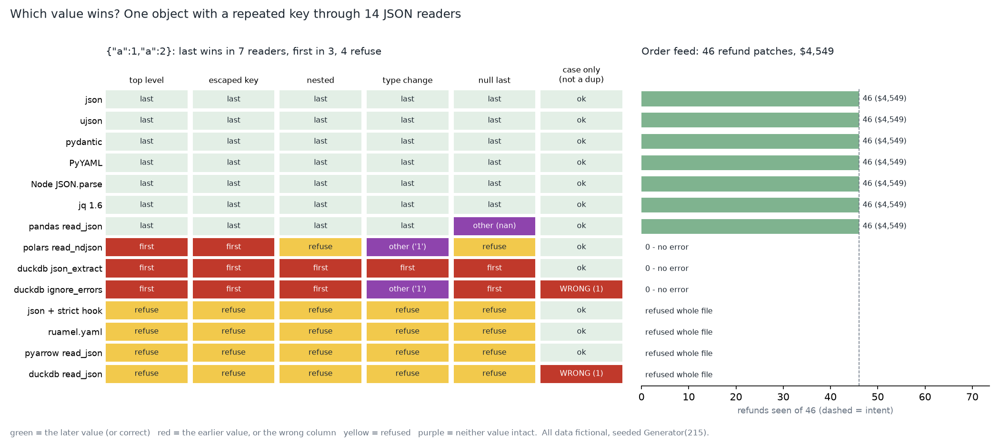

# Which Value Wins?

[](https://colab.research.google.com/github/phoebefu6/phoebe-the-builder/blob/main/data-engineering-pro/duplicate-json-keys/demo.ipynb)
[](https://mybinder.org/v2/gh/phoebefu6/phoebe-the-builder/main?labpath=data-engineering-pro/duplicate-json-keys/demo.ipynb)

> The same order said "paid" in one system and "refunded" in another, because the JSON line named its status twice and the two readers kept different ones.



## The short version

NOT a JSON validator (`json-validator`, Day 12, checks against a schema) and NOT a number-precision test
(`json-number-precision`, Day 214). This sends objects that repeat a key - `{"a":1,"a":2}` - through 14 readers and
records which value comes back. RFC 8259 says names SHOULD be unique and lets a reader keep the last value or
report an error, so every reader here is spec-compliant. They still disagree. Six fixtures plus a fictional
2,000-line order feed, seeded `Generator(215)`, where a refund job patches the status by string concatenation.
Every number is in `evidence.txt`.

| reader | `{"a":1,"a":2}` | nested | `1` then `"x"` | the feed's 46 refunds |
|---|---|---|---|---|
| json, ujson, pydantic, PyYAML, Node JSON.parse, jq 1.6 | last | last | last | 46 seen |
| pandas `read_json(lines=True)` | last | last | last | 46 seen |
| polars `read_ndjson` | **first** | refused | **`'1'` (string)** | **0, no error** |
| duckdb `json_extract` / `->>` | **first** | **first** | **first** | **0, no error** |
| duckdb `read_json(ignore_errors=true)` | **first** | **first** | **`'1'`** | **0, no error** |
| json + strict `object_pairs_hook`, ruamel.yaml, pyarrow, duckdb `read_json` | refused | refused | refused | whole file refused |

## What it found

- **Three camps, 61 of 91 reader pairs disagree** on `{"a":1,"a":2}`: last wins in 7 readers, first in 3, 4 refuse.
  A validator in one camp and a consumer in another act on different values - `{"role":"viewer","role":"admin"}`
  passes a first-wins check and grants admin to a last-wins service.
- **First-wins readers lost every refund with no error.** 46 of 2,000 orders ($4,549.40) carried the refund as the
  second `status`; polars and both duckdb paths reported 0.
- **Strict readers refuse the whole file for one bad row.** pyarrow and duckdb `read_json` return 0 of 2,000 rows
  because of 46 duplicated lines. Correct, loud, and the pressure that makes someone turn on `ignore_errors`.
- **`ignore_errors=true` turns a refusal into first-wins.** Same duckdb process, three entry points: `read_json`
  refuses, `ignore_errors` keeps the first value, `json_extract` keeps the first value.
- **A regex pre-flight misses escaped keys.** `"status"` decodes to `status` in every reader. A grep for a
  repeated quoted key found 30 of 46; across 30 seeds it missed 11-26 per feed. A parser with a strict pairs hook
  found all 46, and missed 0 across all 30 seeds.
- **duckdb reads the wrong column when there is no duplicate.** `{"A":1,"a":2}` is two different names, but duckdb
  identifiers are case-insensitive: the second becomes `a_1` and `select a` returns 1.
- Negative / oddities: pandas turns a `null` last value into NaN (the last value, retyped by the column); polars is
  inconsistent with itself (first at top level, refuses nested and `null`).

## Business Impact
- **Before:** two services read the same event feed and quietly disagree on status, role or amount; nobody can say
  which is right because neither raised an error.
- **After:** one pre-flight parse with a strict pairs hook names every duplicated line before load, and the team
  knows which camp each reader in the path belongs to.
- **Estimated ROI:** illustrative - one reconciliation incident avoided per feed, each usually days of analyst time.

## Tech Stack
Python, json/ujson/pydantic/PyYAML/ruamel.yaml, pandas, polars, pyarrow, duckdb, Node 22, jq 1.6, matplotlib,
Streamlit, Docker.

## Demo

**[Run the interactive demo notebook ->](demo.ipynb)** - pre-rendered with outputs, or click the Colab/Binder badges
above to run it live.

For the Streamlit app (paste one object, see every reader's answer):
```bash
pip install -r requirements.txt
streamlit run app.py
```

Rebuild everything: `python evidence.py && python make_chart.py && python build_notebook.py &&
python -m nbconvert --to notebook --execute demo.ipynb --output demo.ipynb && pytest -q`

## Learning Connection
Continues the JSON arc (Days 128, 213, 214) in Data Engineering practice.
Applies: reading a spec for what it permits rather than what it intends, and testing parsers against each other.

## Impact Note
- **Who benefits:** data engineers owning event ingestion, and security reviewers checking that a validator and a
  service read the same payload.
- **Potential risks:** the reader camps are measured on the versions pinned in `requirements.txt`; a library upgrade
  can change camp. Re-run `evidence.py` after upgrading. All data is fictional.
