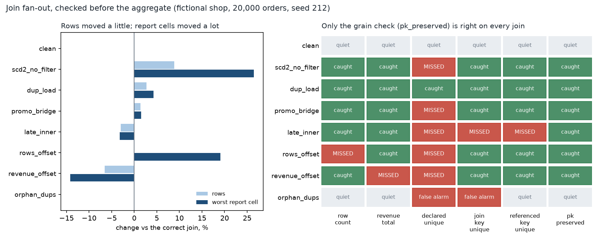

# Revenue Went Up After the Join

[](https://colab.research.google.com/github/phoebefu6/phoebe-the-builder/blob/main/data-engineering-pro/fanout-join-audit/demo.ipynb)
[](https://mybinder.org/v2/gh/phoebefu6/phoebe-the-builder/main?labpath=data-engineering-pro/fanout-join-audit/demo.ipynb)

> A lookup table had two rows for some keys, so the join counted those orders twice and the revenue report went up with no error anywhere - and the uniqueness test the table declares passed.



## The short version

NOT a reference-data versioning study (`reference-data-versioning`, Day 209, showed a code-only history join reports
115.7%) and NOT a deduper (`dedup-pipeline`). This scores the checks a team can put in front of the aggregate. A
fictional shop (2,000 customers, 200 products, 20,000 orders, seeded `Generator(212)`) reports revenue by customer
tier and product category. The join is built eight ways - one correct, six broken, one correct but with harmless
duplicate keys - and six pre-aggregate checks run against each. Every number is in `evidence.txt`.

| join | rows | revenue | worst report cell |
|---|---:|---:|---:|
| `scd2_no_filter` (customer history, forgot `WHERE is_current`) | +8.9% | +14.5% | gold +26.5% |
| `dup_load` (six product rows loaded twice) | +2.7% | +2.5% | kitchen +4.3% |
| `promo_bridge` (promo codes joined in for display) | +1.4% | +1.2% | standard +1.5% |
| `late_inner` (3% of orders' customers not loaded yet, inner join) | -3.0% | -2.8% | gold -3.2% |
| `rows_offset` (missing filter + drops, tuned to cancel in rows) | +0.0% | +6.5% | gold +19.1% |
| `revenue_offset` (same, tuned to cancel in revenue) | -6.5% | +0.0% | platinum -14.2% |

| check (all before the aggregate) | catches (of 6 broken) | false alarms (of 2 correct) |
|---|---:|---:|
| `row_count` - joined rows = source rows | 5 | 0 |
| `revenue_total` - joined sum = source sum, 0.1% | 5 | 0 |
| `declared_unique` - the test the tables declare | **1** | 1 |
| `join_key_unique` - `merge(validate="many_to_one")` | 5 | 1 |
| `referenced_key_unique` - key unique among keys the facts use | 5 | 0 |
| **`pk_preserved` - every source order exactly once in the joined rows** | **6** | **0** |

## What the build found

1. **The declared test passes on the biggest defect.** A type-2 history table is unique on `(customer_id,
   valid_from)`, so that is the test it declares, and it passes. The query joins on `customer_id` alone: +14.5%
   revenue. The test checks the table; the defect is in how the query uses it.
2. **A row tolerance is not a revenue tolerance.** Upgraded customers are 8.9% of orders and 14.5% of revenue, so
   their duplicates move revenue 1.71x as far as rows (median of 30 worlds, lowest 1.48x). Random duplicates (a
   double load, a promo bridge) move both about equally.
3. **Negative result: both totals can be fooled.** A missing filter (rows up) plus an inner join dropping late
   customers (rows down) can cancel in the row count (revenue still +6.5%) or in the revenue total (platinum still
   -14.2%). These two are tuned to cancel exactly; how often real defects cancel is not measured.
4. **Table-level uniqueness false-alarms.** Duplicate keys on discontinued products no order references change
   nothing, and both table tests fire. Restricting to referenced keys removes the false alarm.
5. **The grain check is the one to run.** `pk_preserved` is right on all eight joins. It says *something* broke, not
   which join; `referenced_key_unique` names the dimension. The verdicts are structural: across 30 more worlds every
   check gives the same verdict on every join.

## Business Impact
- **Before:** a revenue number goes up after a model change, someone notices days later, and the hunt starts at the
  dashboard.
- **After:** one assertion between the join and the `GROUP BY` stops the run and points at the dimension.
- **Estimated ROI:** 2-6 hours per fan-out incident saved, and no restated reports.

## Tech Stack
Python, pandas, NumPy, matplotlib, Streamlit, pytest (18 tests: engine claims, notebook-vs-evidence, headless app
with every banner branch reached), Docker.

## Demo

**[Run the interactive demo notebook →](demo.ipynb)** — pre-rendered with outputs, or click the Colab/Binder badges above to run it live.

```bash
pip install -r requirements.txt
python evidence.py && python make_chart.py   # regenerate evidence.txt, results.json, audit.png
streamlit run app.py                         # pick a broken join, see which checks pass it
pytest -q
```

## Learning Connection
Built while studying data modelling and dbt testing (Kimball-style dimensional modelling, type-2 slowly changing
dimensions). Applies: join cardinality, grain assertions, and why a test on a table is not a test on a query.

## Impact Note
- **Who benefits:** analytics engineers and anyone who owns a revenue report built on joins.
- **Potential risks:** `pk_preserved` needs a real primary key on the fact; on a fact without one it cannot be run,
  and a passing grain check says nothing about values that are wrong but not duplicated. Everything here is
  fictional and the two offset cases are constructed.
