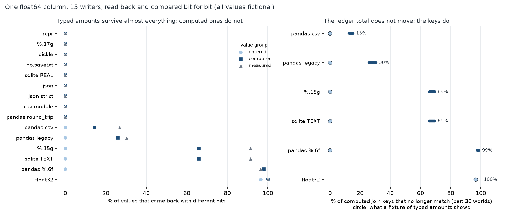

# The Number Changed After a Save

[](https://colab.research.google.com/github/phoebefu6/phoebe-the-builder/blob/main/data-engineering-pro/float-roundtrip/demo.ipynb)
[](https://mybinder.org/v2/gh/phoebefu6/phoebe-the-builder/main?labpath=data-engineering-pro/float-roundtrip/demo.ipynb)

> A value was saved and loaded again and came back a few bits different, so the join on that column quietly stopped matching while the total still reconciled.



## The short version

NOT a currency rounder (`currency-rounder`, Day 143, allocates a total into cents) and NOT a locale parser
(`number-parser-locale`, Day 152, reads "1.234,5"). This takes one float64 column and sends it through 15 ways of
saving and loading it, then compares what comes back bit for bit. There are four groups of fictional values, 2,000
each, seeded `Generator(213)`: typed two-decimal amounts, the same amounts after an FX rate and a 3-way split,
sensor-style readings over 20 orders of magnitude, and 12 edge values. Every number is in `evidence.txt`.

| writer | computed values changed | edge values |
|---|---:|---|
| repr, %.17g, pickle, np.savetxt, json, csv module, pandas `round_trip` | **0%** | all exact |
| SQLite REAL column | 0% | -0.0 -> 0.0, NaN -> NULL |
| strict JSON (`allow_nan=False`) | 0% | NaN and +/-inf refused |
| pandas `to_csv` / `read_csv` defaults | 14.3% (12.7-15.4% over 30 worlds) | 0.30000000000000004 -> 0.3 |
| pandas `read_csv(float_precision='legacy')` | 25.9% | all exact |
| `%.15g` (DBL_DIG, what a spreadsheet shows) | **65.9%** | largest double -> inf |
| SQLite `CAST(v AS TEXT)` | **65.9%** | same as `%.15g`, plus the REAL losses |
| `to_csv(float_format='%.6f')` | 97.9% | subnormals -> 0.0 |
| float32 (a 4-byte FLOAT column) | 100% | 0.1+0.2 -> 0.30000001192092896 |

## What the build found

1. **Seven of 15 writers are bit-exact on everything.** Python's `repr` writes the shortest string that reads back
   to the same double; `%.17g`, pickle, `np.savetxt`, json and the csv module all keep every bit.
2. **A typed-amount fixture passes 14 of 15 writers.** Two-decimal amounts have a short exact decimal form, so
   fifteen digits are enough and only float32 fails. After an FX rate and a split, `%.15g` changes 1,318 of 2,000.
   A test written with tidy sample data will not see this.
3. **The total does not move; the keys do.** After a 15-digit round trip the ledger total over 2,000 computed amounts
   is identical to the last bit (`math.fsum`, 17,798,570.02), so a reconciliation on the sum passes, while 65.9% of
   values no longer equal their source and an exact join or dedupe key on the column misses them.
4. **pandas writes the file correctly and then misreads it.** Every string `to_csv` writes is exact; the default
   `read_csv` parser changes 537 of 2,000 sensor readings, by up to 5,506 ULP on small values.
   `float_precision='round_trip'` reads every one back exactly. The `legacy` parser is off more often (605) but by at
   most 2 ULP.
5. **SQLite has two different answers.** A REAL column keeps every finite bit but stores NaN as NULL and -0.0 as 0.0.
   A text cast (SQLite 3.51.1 here) uses 15 digits and matches `%.15g` value for value.
6. **Negative result: the money barely moves.** Even `%.6f` shifts the total by $0.000013 and float32 by $0.018 on
   $17.8M. If the only check is the sum, none of this shows up, which is the point.

## Business Impact
- **Before:** a reload or export changes values below the display precision, a join loses rows, and the hunt starts
  at the join logic.
- **After:** the writer is chosen on evidence (repr / %.17g / binary / pandas `round_trip`), and the round trip is
  tested with computed values, not typed ones.
- **Estimated ROI:** 2-4 hours per "the rows do not match after the export" incident.

## Tech Stack
Python (csv, json, pickle, sqlite3, struct), pandas, NumPy, matplotlib, Streamlit, pytest (19 tests: engine claims,
notebook-vs-evidence, notebook prose numbers, headless app with every banner branch reached), Docker.

## Demo

**[Run the interactive demo notebook →](demo.ipynb)** — pre-rendered with outputs, or click the Colab/Binder badges above to run it live.

```bash
pip install -r requirements.txt
python evidence.py && python make_chart.py   # regenerate evidence.txt, results.json, roundtrip.png
streamlit run app.py                         # type a value, pick a writer, see the bits
pytest -q
```

## Learning Connection
Built while studying IEEE 754 binary64 and serialisation formats. Applies: shortest round-trip printing, why 17
significant digits are needed and 15 are only guaranteed the other way, ULP distance, and reading a parser's
precision option rather than trusting its default.

## Impact Note
- **Who benefits:** data engineers who move numeric columns through CSV, SQLite, JSON or spreadsheets, and anyone
  who joins or deduplicates on a float.
- **Potential risks:** bit equality is the right test for a key, not for a measurement; for amounts, store integers
  of minor units or decimals and the problem goes away. Results are for this interpreter (Python 3.11, pandas 2.1.4,
  SQLite 3.51.1); other versions may differ. Every value is fictional.
