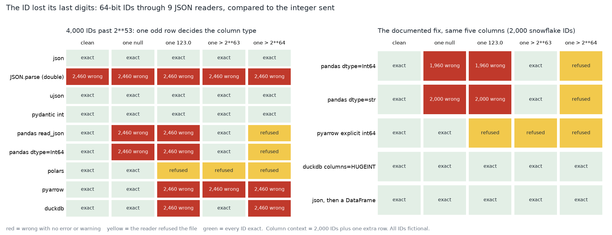

# The ID Lost Its Last Digits

[](https://colab.research.google.com/github/phoebefu6/phoebe-the-builder/blob/main/data-engineering-pro/json-number-precision/demo.ipynb)
[](https://mybinder.org/v2/gh/phoebefu6/phoebe-the-builder/main?labpath=data-engineering-pro/json-number-precision/demo.ipynb)

> A 64-bit customer ID went through a JSON reader and came back a few digits different, with no error, because one null in the same column turned the whole column into floating point.



## The short version

NOT a float round-trip test (`float-roundtrip`, Day 213, sends float64 values through writers) and NOT a JSON
flattener (`json-flattener`, Day 128). This sends 64-bit integer IDs through 9 JSON readers and compares what comes
back to the integer that was sent. A single big ID usually survives; what breaks it is the column, because readers
choose one type per column and one odd row decides it. So every group is parsed clean and with one extra row: a
null, a `123.0`, an ID above 2**63, an ID above 2**64. Three fictional groups of 2,000, seeded `Generator(214)`:
sequential keys below 2**31, a counter crossing 2**53, and Twitter-style snowflake IDs. Every number is in
`evidence.txt`.

| reader | clean | one null | one 123.0 | one > 2**63 | one > 2**64 |
|---|---|---|---|---|---|
| json, ujson, pydantic | exact | exact | exact | exact | exact |
| JSON.parse (Node, and jq 1.6: identical values) | **wrong** | **wrong** | **wrong** | **wrong** | **wrong** |
| pandas `read_json` (also with `dtype='Int64'`) | exact | **wrong** | **wrong** (dtype still int64) | exact | refused |
| polars | exact | exact | refused | refused | refused |
| pyarrow | exact | exact | **wrong** | **wrong** | **wrong** |
| duckdb | exact | exact | **wrong** | exact | **wrong** |

"wrong" = 2,460 of the 4,000 IDs past 2**53 changed, with no error and no warning.

## What the build found

1. **Only 3 of 9 readers are exact in every context** (json, ujson, pydantic). 14 of 45 reader-contexts change IDs
   silently. Every reader except JSON.parse is exact on a clean column; the failure needs the odd row, which is why
   testing on a clean file finds nothing.
2. **Small IDs never fail.** Keys below 2**31 come back exact in all 45 reader-contexts, so a fixture of ordinary
   database keys passes every reader.
3. **pandas reports int64 while the values are wrong.** With one `123.0` in the column, `read_json` parses through a
   double and casts back: `df.dtypes` says int64 and 1,960 of 2,000 snowflake IDs are wrong. A dtype check passes.
4. **The usual pandas fixes do not fix it.** `dtype={'id': 'Int64'}` casts after the rounding (1,960 wrong with a
   null). `dtype=str` is worse: it hands back strings like `2.0640592815436145e+18` for all 2,000.
5. **What a wrong ID does depends on where it lives.** On the counter crossing 2**53, every odd ID is off by one
   and 499 merge with a neighbour: two customers, one key. Snowflake IDs near 2**60 are off by up to 63 but only
   3-10 of 2,000 collide over 30 seeds; the join misses instead of merging.
6. **Where a clean column starts rounding:** JSON.parse at 2**53 + 1, pyarrow at 2**63 + 1, duckdb at 2**64 + 1;
   pandas refuses past 2**64 rather than round. The real Node 22 `JSON.parse` and jq 1.6 return exactly the values
   of the Python double simulation.
7. **Fixes that hold in all five columns:** duckdb `columns={'id': 'HUGEINT'}`, and parsing with `json` before
   building the DataFrame. pyarrow's explicit int64 schema is correct and loud (it refuses the file). In Node, a
   reviver reading `context.source` into BigInt got all 6,000 IDs exact.

## Business Impact
- **Before:** an export or API sync silently changes some IDs, the downstream join drops or merges customers, and
  the hunt starts in the join logic because the column type looks right.
- **After:** the reader is chosen on evidence, tested with a null, a `123.0` and an oversized row in the ID column,
  and IDs cross JavaScript boundaries as strings.
- **Estimated ROI:** 2-4 hours per "these customer IDs do not exist" incident, plus the merged-customer cases that
  are never noticed.

## Tech Stack
Python (json), ujson, pydantic, pandas, polars, pyarrow, DuckDB, Node.js and jq (evidence only), matplotlib,
Streamlit, pytest (19 tests: engine claims, notebook-vs-evidence, notebook prose numbers, headless app with every
banner branch reached), Docker.

## Demo

**[Run the interactive demo notebook →](demo.ipynb)** — pre-rendered with outputs, or click the Colab/Binder badges above to run it live.

```bash
pip install -r requirements.txt
python evidence.py && python make_chart.py   # regenerate evidence.txt, results.json, precision.png
streamlit run app.py                         # type an ID, pick the odd row, see what each reader returns
pytest -q
```

## Learning Connection
Built while studying IEEE 754 binary64 and JSON (RFC 8259 section 6 warns about exactly this range). Applies: the
2**53 integer limit, per-column type inference, and testing a parser with the rows that decide its type rather than
the rows that are typical.

## Impact Note
- **Who benefits:** data engineers and API developers moving 64-bit keys through JSON, especially into JavaScript,
  pandas or a lakehouse loader.
- **Potential risks:** results are for these versions (Python 3.11, pandas 2.1.4, polars 1.41.2, pyarrow 14.0.2,
  duckdb 1.5.3, Node 22.6, jq 1.6; jq 1.7 keeps integer literals). Newer releases may change inference. All IDs
  are fictional.
