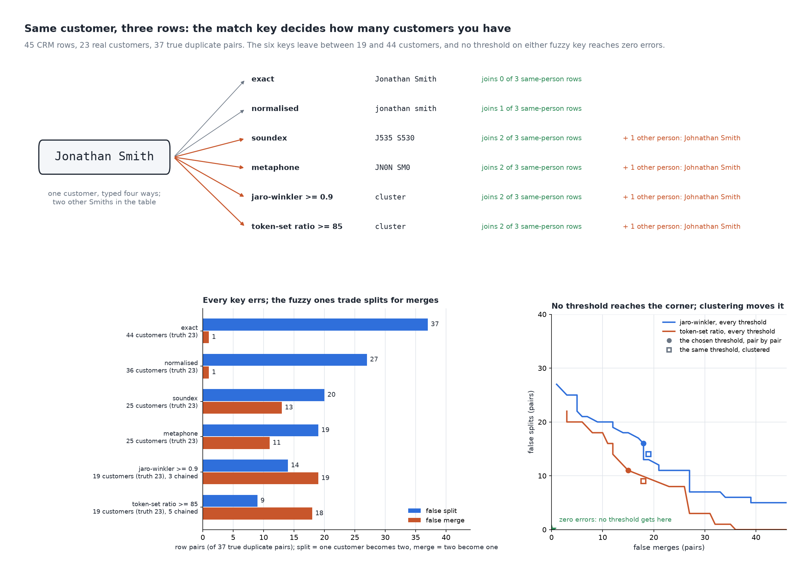

# Same Customer, Three Rows

[](https://colab.research.google.com/github/phoebefu6/phoebe-the-builder/blob/main/data-quality-governance/dedupe-key-choice/demo.ipynb)
[](https://mybinder.org/v2/gh/phoebefu6/phoebe-the-builder/main?labpath=data-quality-governance/dedupe-key-choice/demo.ipynb)

> The same customer typed three ways is three rows, and the key a dedupe script matches on decides how many customers the table has: six keys leave anywhere from 44 to 19 customers for 23 real people. The exact string splits every true pair and still merges the two John Smiths, a fuzzy cluster joins Anna Schmidt to Anna Müller at a score of 53 out of 100, and no threshold on either fuzzy key reaches zero errors.



## The short version

NOT a deduper: `dedup-pipeline` (Day 67) merges clusters into golden records. This is the step before it, the
choice of KEY that decides which rows are the same. 45 fictional CRM rows belonging to 23 real customers, each row
hand-labelled with who it is (the same person typed three ways, or two different people who share a name). Six keys:
exact string, normalised (case, accents, punctuation, titles, token order), Soundex, Metaphone, Jaro-Winkler at 0.9,
token-set ratio at 85. The two fuzzy keys are pairwise, and the table is then clustered by connected components,
which is what every fuzzy dedupe script does whether it says so or not. No randomness.

| key | false splits (of 37) | false merges | customers (truth 23) | chained pairs |
|---|---:|---:|---:|---:|
| exact | 37 | 1 | 44 | 0 |
| normalised | 27 | 1 | 36 | 0 |
| soundex | 20 | 13 | 25 | 0 |
| metaphone | 19 | 11 | 25 | 0 |
| jaro-winkler >= 0.9 | 14 | 19 | 19 | 3 |
| token-set ratio >= 85 | **9** | 18 | 19 | 5 |

- **The exact string only splits, and still merges.** Every one of the 37 true pairs stays apart; the one pair it
  joins is the two different `John Smith`s, the one pair no key can keep apart.
- **Normalising closes 10 pairs and opens none.** Token order (`Smith, Jonathan`), accents (`José Núñez`) and titles
  fold away. An apostrophe does not: `O'Brien` folded to `o brien` is not `OBrien`, so the fold must choose whether
  punctuation is a space or nothing, and either choice is wrong for one form.
- **Phonetic and fuzzy keys buy fewer splits with merges of different people.** `jon` and `john` are both J500, so
  every phonetic and fuzzy key files `Jon Smith` with both `John Smith`s; `Catherine Lee` meets `Catherine Leigh`;
  `Stephen Baker` meets `Stefan Becker`. Jaro-Winkler at 0.9 leaves 19 customers, fewer than the truth.
- **A cluster joins rows that never matched.** `Anna Schmidt` and `Anna Müller` score 53 on the token-set ratio,
  far below 85, and end up as one customer because `Anna Müller-Schmidt` matched each of them. Judged pair by pair
  the token-set key makes 11 splits and 15 merges; clustered it makes 9 and 18.
- **The keys disagree with each other, not just with the truth.** The token-set key joins 45 pairs the exact string
  keeps apart; Soundex and Metaphone disagree on 3 pairs between them.

**Negative result (the frontier and the floor):** judged pair by pair at every threshold the similarities take, the
best Jaro-Winkler threshold (0.969) makes 22 splits and 5 merges, the best token-set threshold (96.552) 20 and 3,
and no threshold reaches zero of both, because a one-letter typo in one person's name scores the same as a
one-letter difference between two people. And 7 of the 37 true pairs are joined by no key here at all:
`William Jones` and `Bill Jones`, `Mohammed Al-Sayed` and `Mohamed Alsayed`. A nickname and a transliteration are
not spelling variants; nothing computed from the string recovers them.

**What to do:** treat the key as a decision with two priced errors, not a preprocessing step. Label a sample of
your own table, count false splits and false merges per key, and pick the one whose errors you can afford. Keep
the ambiguous band (a fuzzy score near the threshold, a cluster whose members never matched each other) for a
person, and add a second field (email, phone, postcode) to the key, since a name alone has a floor no string
function moves. `dedup-pipeline` picks up from there.

## Business Impact
- **Before:** a dedupe script picked its key by habit (`lower(trim(name))`, or a fuzzy library at its default
  threshold), and the customer count moved by 25 with nobody able to say which number was right.
- **After:** every candidate key scored on the same labelled sample by both errors, the chained merges named, and
  the pairs no key recovers routed to a person or a second field.
- **Estimated ROI:** normalising cuts false splits from 37 to 27 of 37 at no merge cost; going fuzzy from there cuts
  splits to 9 at a cost of 18 merged customers, each a shared consent and order history.

## Tech Stack
Python, jellyfish (Soundex, Metaphone, Jaro-Winkler), rapidfuzz (token-set ratio), matplotlib, Streamlit, pytest,
Docker.

## Demo

**[Run the interactive demo notebook →](demo.ipynb)** — pre-rendered with outputs, or click the Colab/Binder badges above to run it live.

For the Streamlit app (paste your own names, see the key every scheme makes and how many customers each leaves):
```bash
pip install -r requirements.txt
python evidence.py && python make_chart.py   # writes results.json, evidence.txt, audit.png
streamlit run app.py
```

Files: `explore.py` (corpus, keys, clustering, frontier, ceiling), `evidence.py` (writes `evidence.txt`),
`make_chart.py` (figure with a geometry self-check), `build_notebook.py` (generates `demo.ipynb`), `test_*.py`.

## Learning Connection
Built while studying data quality and governance for the CDAIO track (record linkage: Fellegi-Sunter, Soundex and
Metaphone, Jaro-Winkler).
Applies: measuring a match key by false splits and false merges, and showing that a pairwise threshold is not the
same decision as the cluster it produces.

## Impact Note
- **Who benefits:** CRM, marketing-ops and data teams deduplicating customers on a name column, and anyone reviewing
  a vendor's "fuzzy matching" claim.
- **Potential risks:** 45 rows chosen to cover each failure, not a sample of a real table; thresholds and errors on
  your data will differ. A merge decided on a name can also merge consent and order history, so a false merge is a
  privacy incident, not just a duplicate.
