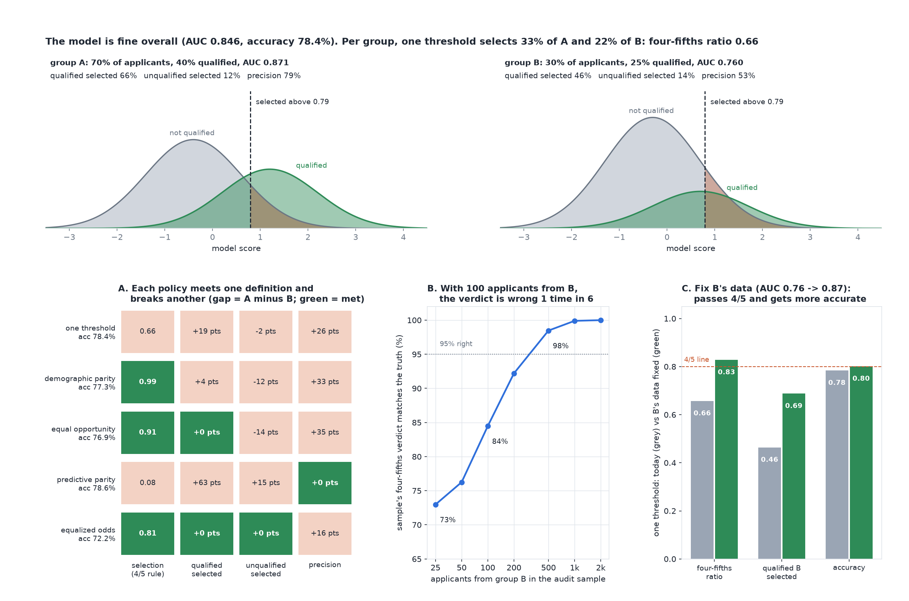

# The Model Is Fine Overall

[](https://colab.research.google.com/github/phoebefu6/phoebe-the-builder/blob/main/data-quality-governance/disparate-impact/demo.ipynb)
[](https://mybinder.org/v2/gh/phoebefu6/phoebe-the-builder/main?labpath=data-quality-governance/disparate-impact/demo.ipynb)

> The screening model is 78% accurate with an AUC of 0.85, and it selects a qualified applicant from the smaller group 46% of the time against 66% for everyone else. Every fix we tried met one definition of fair and broke another.



## The short version

A screening model scores applicants from two groups. Group B is 30% of applicants, 25% of them qualified against
group A's 40%, and the score separates B's qualified from its unqualified less well (AUC 0.760 against 0.871),
because the training data held fewer of them. Within each group, scores are normal given the label, so every rate
is exact: selection rate, the share of qualified applicants selected (true positive rate), the share of
unqualified applicants selected (false positive rate), precision, and the EEOC four-fifths ratio.

The world is constructed and declared. `resume-screener` is the kind of model this audits; the privacy builds
(`pii-detector`, `consent-tracker`) answer a different question.

| policy | accuracy | 4/5 ratio | qualified selected A / B | unqualified selected A / B | precision A / B |
|---|---:|---:|---:|---:|---:|
| one threshold for everyone | 78.4% | 0.657 | 65.9% / 46.4% | 11.7% / 13.8% | 79.0% / 52.9% |
| demographic parity | 77.3% | 0.995 | 61.8% / 57.9% | 9.7% / 21.2% | 81.0% / 47.7% |
| equal opportunity | 76.9% | 0.914 | 60.3% / 60.3% | 9.0% / 23.0% | 81.7% / 46.7% |
| predictive parity | 78.6% | 0.083 | 72.9% / 9.7% | 16.1% / 1.1% | 75.1% / 75.1% |
| equalized odds | 72.2% | 0.813 | 46.3% / 46.0% | 13.6% / 13.6% | 69.5% / 53.1% |

## What it found

1. **Fine overall, not fine per group.** At the accuracy-maximising threshold, the four-fifths ratio is 0.657,
   and a qualified B applicant is selected 46.4% of the time against 65.9% for A.
2. **Every fix meets one definition and breaks another.** Demographic parity selects unqualified B applicants at
   twice A's rate. Equal opportunity does the same. Predictive parity, the most accurate of the five, selects 3.2%
   of group B.
3. **Three definitions cannot all hold.** With different base rates, equal precision and equal true positive rate
   force unequal false positive rates (Chouldechova, 2017). None of 56,977 threshold pairs meets all three within
   2 points; the closest misses by 12.9.
4. **Equalized odds levels down.** B's ROC curve sits under A's, so equal true and false positive rates are only
   reachable by moving A onto B's point: 12% of A applicants are judged at a threshold that admits almost
   everyone, the rest at a much stricter one. Accuracy falls 6.3 points and A's qualified applicants lose 20 points
   of selection. Nobody in B gains.
5. **A small audit cannot tell.** Drawing applicants in the real proportions, the four-fifths verdict on a sample
   with 100 applicants from B matches the population's only 84.5% of the time. About 500 are needed for 98%.
6. **Fixing the data does what no threshold can.** Make B's score as informative as A's, base rates unchanged:
   one threshold passes four-fifths (0.828) and accuracy rises to 80.2%. Equalized odds then costs nothing.
7. **Negative result.** The precision gap survives the data fix (79.3% against 63.2%), and equalising true
   positive rates then fails the four-fifths rule (0.759). Those come from the base rates, and no model quality
   removes them. Choosing a fairness definition is a policy decision, not a modelling one.

Calibration: 40 of 40 exact rates sit inside the 99% Wilson interval of 200,000 simulated applicants per policy
(seed 196). Full output in [evidence.txt](evidence.txt).

## Business Impact
- **Before:** a model ships on its overall accuracy, a fairness review computes one metric, and an audit on a few
  hundred records returns a confident verdict.
- **After:** every group rate is shown side by side, the definition being enforced is named with what it breaks,
  the audit sample is sized for the verdict it has to support, and the data gap is priced against threshold fixes.
- **Estimated ROI:** a fairness decision made on purpose and documented, instead of discovered in an audit or a
  complaint.

## Tech Stack
Python, NumPy and SciPy (exact rates from binormal scores), Matplotlib, Streamlit, pytest, Docker.

## Demo

**[Run the interactive demo notebook →](demo.ipynb)** - pre-rendered with outputs, or click the Colab/Binder badges above to run it live.

For the Streamlit app (set your own groups' base rates and score quality):
```bash
pip install -r requirements.txt
python evidence.py && python make_chart.py
streamlit run app.py
```

## Files
- `fairness.py` - the engine: exact rates, five policies, the impossibility search, audit power, the data fix
- `evidence.py` - runs the study, writes `results.json` and `evidence.txt`
- `make_chart.py` - the audit figure, with a geometry self-check before saving
- `build_notebook.py` - generates `demo.ipynb` with the engine extracted from `fairness.py`
- `test_fairness.py`, `test_notebook.py`, `test_app.py` - 28 tests

## Learning Connection
Built while studying *Fairness and Machine Learning* (Barocas, Hardt and Narayanan), Chouldechova (2017) on
recidivism prediction, Hardt, Price and Srebro (2016) on equality of opportunity, and the EEOC Uniform Guidelines
four-fifths rule (29 CFR 1607.4(D)). Applies: group fairness metrics, the impossibility result, post-processing
for equalized odds, and sizing an audit sample.

## Impact Note
- **Who benefits:** teams building or auditing screening, lending and eligibility models.
- **Potential risks:** the world is constructed with two groups and normal scores; real groups are many,
  intersecting and unevenly measured. The four-fifths rule is a screening heuristic in US employment practice, not
  a legal test of discrimination everywhere. Use this to make the trade-offs visible, then take the decision to the
  people accountable for it, with legal advice where the law applies.
