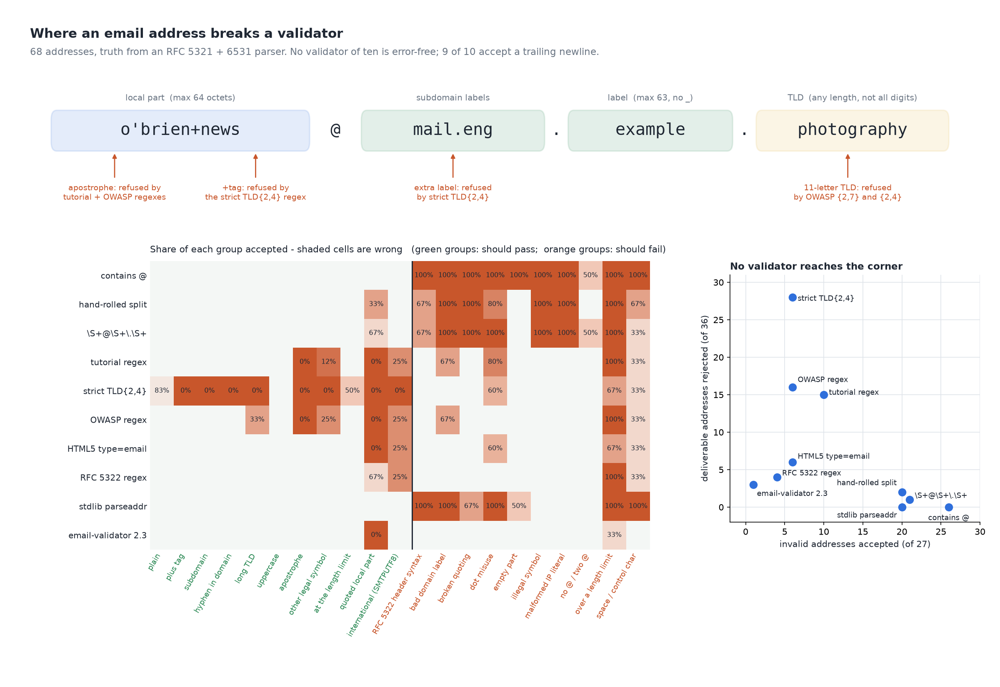

# The Valid Address Was Rejected

[](https://colab.research.google.com/github/phoebefu6/phoebe-the-builder/blob/main/data-quality-governance/email-validator/demo.ipynb)
[](https://mybinder.org/v2/gh/phoebefu6/phoebe-the-builder/main?labpath=data-quality-governance/email-validator/demo.ipynb)

> A customer called O'Brien cannot sign up because the form says their real address is invalid, while the same form accepts an address with a newline on the end. Ten validators people actually paste into code, checked against the RFC, show which real customers each one turns away and what each one lets through.



## The short version

68 hand-labelled addresses: 36 deliverable, 5 valid-but-local (`user@localhost`, IP literals, a numeric TLD), 27
invalid. Truth comes from a reference parser for RFC 5321 (SMTP mailbox grammar and length limits) plus RFC 6531
(international addresses), and it agrees with an independent hand label on every row. Regexes are applied the way
they are pasted: `re.match` on a `^...$` pattern. Nothing is random; every number is exact.

| validator | deliverable rejected (of 36) | invalid accepted (of 27) | sign-ups lost* |
|---|---:|---:|---:|
| `"@" in s` | 0 | 26 | 0.00% |
| hand-rolled split | 2 | 20 | 0.01% |
| `\S+@\S+\.\S+` | 1 | 21 | 0.00% |
| tutorial regex `[a-zA-Z0-9._%+-]+@...{2,}` | 15 | 10 | 1.18% |
| strict `{2,4}` TLD regex | 28 | 6 | **24.64%** |
| OWASP regex (TLD capped at 7) | 16 | 6 | 2.16% |
| HTML5 `type=email` pattern | 6 | 6 | 0.79% |
| "RFC 5322" regex (emailregex.com) | 4 | 4 | 0.78% |
| `email.utils.parseaddr` | 0 | 20 | 0.00% |
| `email-validator` 2.3 | 3 | 1 | 0.01% |

\* Declared assumption, not data: 88% plain addresses, 3% plus-tags, 1.04% international, and so on (`SHARE` in
`explore.py`; the app lets you set your own mix).

- **The copy-pasted regexes refuse real people.** Apostrophes (O'Brien, D'Angelo) and international addresses
  (legal since RFC 6531, 2012) are each refused by 3 to 5 of the 10.
- **The permissive checks refuse nobody and accept almost anything.** `parseaddr` passes `John <john@example.com>`,
  so what lands in the database is not an address.
- **9 of 10 accept `john@example.com\n`.** Python's `$` matches before a final newline. That is a header-injection
  risk, not a typo. Only the library refuses it.
- **No validator is error-free.** A 65-octet local part passes all ten: `email-validator` only enforces RFC 5321's
  64-octet limit with `strict=True`.
- **Stacking does not help.** Browser HTML5 + tutorial regex + library rejects 15 deliverable addresses (1.18% of
  sign-ups): exactly the tutorial regex's list. A stack is as strict as its strictest member.

**Negative result:** syntax cannot settle deliverability. Every validator here, the reference included, passes
addresses no mailbox will ever receive. The only proof is sending a confirmation email.

**What to do:** strip and refuse control characters first, then use a maintained library (decide on purpose about
quoted local parts and `strict`), then confirm by sending. Never ship a hand-written regex.

## Business Impact
- **Before:** a support ticket per refused customer, and nobody can say which rule refused them.
- **After:** every validator's refusals named by group, priced against your own sign-up mix.
- **Estimated ROI:** ~1-2% of sign-ups recovered when a tutorial or OWASP regex is replaced.

## Tech Stack
Python, email-validator, matplotlib, Streamlit, pytest, Docker.

## Demo

**[Run the interactive demo notebook →](demo.ipynb)** — pre-rendered with outputs, or click the Colab/Binder badges above to run it live.

For the Streamlit app (paste your own addresses, set your own sign-up mix):
```bash
pip install -r requirements.txt
python evidence.py && python make_chart.py   # writes results.json, evidence.txt, audit.png
streamlit run app.py
```

Files: `explore.py` (reference parser, corpus, the ten validators), `evidence.py` (writes `evidence.txt`),
`make_chart.py` (figure with a geometry self-check), `build_notebook.py` (generates `demo.ipynb`), `test_*.py`.

## Learning Connection
Built while studying data quality and governance for the CDAIO track.
Applies: validating against a written specification rather than a sample, and naming who a rule excludes.

## Impact Note
- **Who benefits:** product, growth and data teams who own a sign-up or import form.
- **Potential risks:** the sign-up mix is an assumption; the corpus is 68 rows chosen to cover each rule, not a
  sample of traffic. Accepting more syntax does not make an address real.
