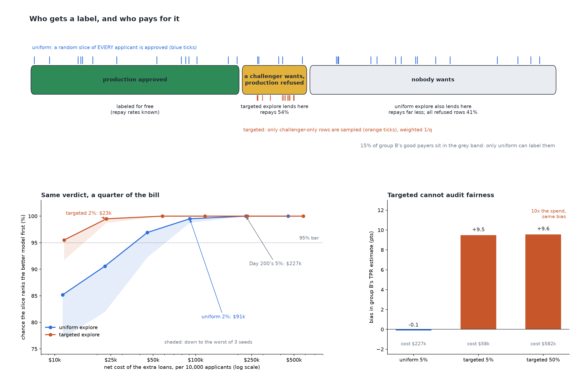

# What Does a Random-Approval Slice Cost?

[](https://colab.research.google.com/github/phoebefu6/phoebe-the-builder/blob/main/data-quality-governance/exploration-budget/demo.ipynb)
[](https://mybinder.org/v2/gh/phoebefu6/phoebe-the-builder/main?labpath=data-quality-governance/exploration-budget/demo.ipynb)

> We know a random-approval slice is the only honest way to judge a credit model, and risk wants to know what it costs in bad loans. Lending only where a challenger disagrees with production gets the same verdict for a quarter of the losses, and it cannot do the fairness audit at any price.



## The short version

Same declared world as [`selective-labels`](../selective-labels): officers approved 40% on a bureau score plus an
interview read nobody recorded, with a higher bar for group B. Two challengers: the oracle (truly 6.4 pts better on
repayment) and the model a team can train on labels. The labeled rows rank them the wrong way round. Two ways to buy
unbiased labels, each replayed 400 times per point on 40,000 applicants, three seeds. Unit economics declared:
+$300 per repaid loan, -$1,500 per default. Costs per 10,000 applicants.

- **Uniform:** approve a random share of all applicants.
- **Targeted:** production's approvals are already labeled; approve a random share of only the rows a challenger
  wants and production refused, weighted 1/q.

| | uniform | targeted |
|---|---:|---:|
| repay rate of the rows it lends into | 41.3% | 54.3% |
| cheapest slice ranking right 95% at every seed | 2% | 2% |
| extra loans / net cost | 120 / **$90,810** | 44 / **$23,280** (3.9x cheaper) |
| at matched spend (~$23k): chance of ranking right | 90.6% (uniform 0.5%) | **99.5%** (targeted 2%) |
| bias in group B's TPR estimate, 5% slice | -0.1 pts | **+9.5 pts** |
| same, 50% targeted slice ($581,988) | | +9.6 pts |

**Day 200 oversized the slice.** Its 5% ($227,025) bought a +/-2.6 point interval on one model's repay level.
Choosing between two models is a paired question; the approvals they share cancel, and 2% ranks them right.

**Negative result:** targeted cannot audit fairness. 15.2% of group B's good payers are wanted by nobody, so a
design that only lends where someone wants to never labels them, and the TPR estimate for B stays ~9.5 pts high
whether targeted spend is 5% or 50%. Both designs are unbiased for repay (bias under 0.35 pts at every point).

**What to do:** pick between models on a targeted slice; keep a small uniform slice for the fairness audit, sized
to the audit's precision, not the model choice.

## Business Impact
- **Before:** risk either refuses exploration as too expensive or copies a 5% rule of thumb.
- **After:** the cost of each verdict is priced in dollars for your own loan economics, per design.
- **Estimated ROI:** ~$200k of avoidable losses per 10,000 applicants vs the 5% uniform slice, for the same model choice.

## Tech Stack
Python, NumPy, scikit-learn (HistGradientBoosting), matplotlib, Streamlit, pytest, Docker.

## Demo

**[Run the interactive demo notebook →](demo.ipynb)** — pre-rendered with outputs, or click the Colab/Binder badges above to run it live.

For the Streamlit app (your own margin, loss and confidence target):
```bash
pip install -r requirements.txt
python evidence.py && python make_chart.py   # writes results.json, evidence.txt, audit.png
streamlit run app.py
```

Files: `explore.py` (engine), `evidence.py` (the study, writes `evidence.txt`), `make_chart.py` (figure with a
geometry self-check that now requires a 3px gap between labels), `build_notebook.py` (notebook generator, engine
extracted by AST), 19 tests.

## Learning Connection
Built while studying counterfactual evaluation and credit-risk material (exploration budgets, stratified sampling,
selective labels). Applies: paired vs level precision, stratified sampling with known inclusion probability,
positivity limits of any design that only samples where someone already wants to act.

## Impact Note
- **Who benefits:** credit risk and model validation teams sizing an exploration budget; anyone whose labels come from past decisions.
- **Potential risks:** the world and the unit economics are declared, so the dollar figures are this world's. Any
  random approval lends to people a score would refuse and needs governance sign-off; targeted exploration on its
  own will hide unfairness against people nobody would approve.
