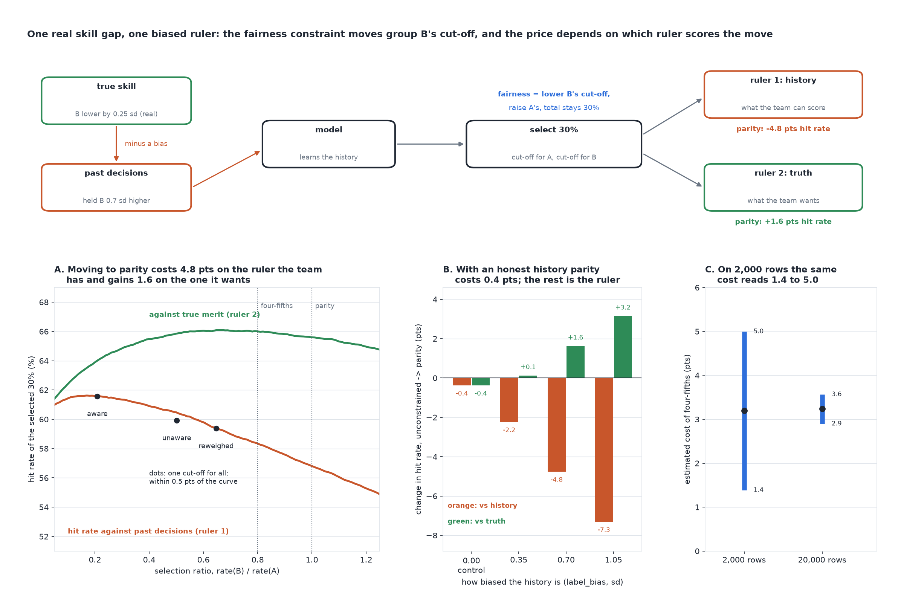

# What Does Fairness Cost?

[](https://colab.research.google.com/github/phoebefu6/phoebe-the-builder/blob/main/data-quality-governance/fairness-accuracy-frontier/demo.ipynb)
[](https://mybinder.org/v2/gh/phoebefu6/phoebe-the-builder/main?labpath=data-quality-governance/fairness-accuracy-frontier/demo.ipynb)

> Everyone says fairness costs accuracy, and nobody has measured how much. Measured against our past decisions, parity cost us almost 5 points. Measured against who was actually qualified, it gained us 1.6.



## The short version

Two groups of applicants, B is 30% of them. Unlike `proxy-variable-finder`, the groups really do differ: B's true
skill is 0.25 standard deviations lower. On top of that, past decisions, which are the training labels, held B to a
0.7 sd higher bar. Both labels share the same noise, so they differ only by that bias.

A gradient-boosting model learns the history. The company selects 30% of applicants. The frontier is drawn by
group-specific cut-offs: for every selection ratio from 0.05 to 1.25, take the top scores in each group so the total
stays 30% and rate(B) / rate(A) hits the target, then measure the **hit rate** (share of the selected who are
positive) against two rulers: the past decisions (what the team can score) and true merit (what it wants). Three
seeds, n = 60,000 each, min-max spread reported.

| move from the unconstrained model (ratio 0.21) | hit rate vs past decisions | hit rate vs true merit |
|---|---:|---:|
| to four-fifths (0.80) | -3.2 pts | **+2.0 pts** |
| to parity (1.00) | -4.8 pts [-5.2 to -4.4] | **+1.6 pts** [+1.4 to +2.0] |

| how biased the history is | price of parity vs history | vs truth |
|---:|---:|---:|
| 0.00 (control: history = truth) | -0.4 | -0.4 |
| 0.35 | -2.2 | +0.1 |
| 0.70 | -4.8 | +1.6 |
| 1.05 | -7.3 | +3.2 |

## What it found

1. **The price depends on the ruler.** Against past decisions, parity costs 4.8 points of hit rate. Against true
   merit, the same move gains 1.6. The unconstrained model was reproducing the old bar, and the only ruler most teams
   have rewards it for that.
2. **The real price is small because the curve is flat at the top.** With an honest history the two rulers are the
   same labels, and parity costs 0.39 points despite a real 0.25 sd skill gap. The applicants a constraint swaps sit
   at the cut-off, where both groups are almost equally likely to be qualified. Along the honest curve the hit rate
   moves only from 66.0% at ratio 0.5 to 65.8% at parity.
3. **Everything above that is the ruler, and it grows with the bias**: 0 at no bias, 2.4, 6.4, 10.5 points of gap
   between the two rulers as the bias rises.
4. **Negative result: the legal options are not inside the frontier.** I expected one-cut-off models (group removed,
   zip dropped, Kamiran-Calders reweighing) to be dominated by group-specific cut-offs. They are not: all land within
   0.5 points of the curve. What they cannot do is get past a ratio of about 0.65. Reaching four-fifths here takes
   explicit group-specific cut-offs, which some jurisdictions forbid.
5. **The estimate is noisy.** Estimated on a 2,000-row validation sample, the 3.2-point cost of four-fifths reads
   anywhere from 1.4 to 5.0 points (90% of samples); on 20,000 rows, 2.9 to 3.6.

Full output in [evidence.txt](evidence.txt).

## Business Impact
- **Before:** "fairness will cost us accuracy" is asserted, priced at one point if at all, and measured against the
  same historical decisions the model was trained to reproduce.
- **After:** the whole curve is drawn, the price is reported as a range, and the share of it that is the biased
  yardstick is separated from the share that is real, using a re-labelled audit sample or an outcome observed later.
- **Estimated ROI:** a fairness decision argued on measured numbers. In this world the "cost" a team would have
  reported was 4.8 points; the real effect on the people selected was a 1.6-point improvement.

## Tech Stack
Python, scikit-learn (gradient boosting), NumPy, Matplotlib, Streamlit, pytest, Docker.

## Demo

**[Run the interactive demo notebook →](demo.ipynb)** - pre-rendered with outputs, or click the Colab/Binder badges above to run it live.

For the Streamlit app (set the real skill gap and how biased the history was):
```bash
pip install -r requirements.txt
python evidence.py && python make_chart.py
streamlit run app.py
```

## Files
- `frontier.py` - the engine: the world, four models, group-specific cut-offs, the frontier, the bias sweep, the audit
- `evidence.py` - runs the study, writes `results.json` and `evidence.txt`
- `make_chart.py` - the figure, with a geometry self-check before saving
- `build_notebook.py` - generates `demo.ipynb` with the engine extracted from `frontier.py`
- `test_frontier.py`, `test_notebook.py`, `test_app.py` - 22 tests

## Learning Connection
Built while studying *Fairness and Machine Learning* (Barocas, Hardt and Narayanan) on the cost of fairness
constraints, Corbett-Davies et al. (2017), "Algorithmic decision making and the cost of fairness", and Kamiran and
Calders (2012) on reweighing. Applies: post-processing with group thresholds, Pareto frontiers, label bias, and
sampling uncertainty in an audit.

## Impact Note
- **Who benefits:** teams deciding whether to apply a fairness constraint, and the leaders who have to sign off on its
  price.
- **Potential risks:** true merit is known in this world; in practice the second ruler has to be built (an audit
  sample re-labelled by blind reviewers, or an outcome observed later) and can carry its own bias. A real skill gap
  was declared here; a team that assumes all of a gap is bias, or none of it, will misprice the constraint.
  Group-specific cut-offs are explicit disparate treatment and are unlawful in some settings.
