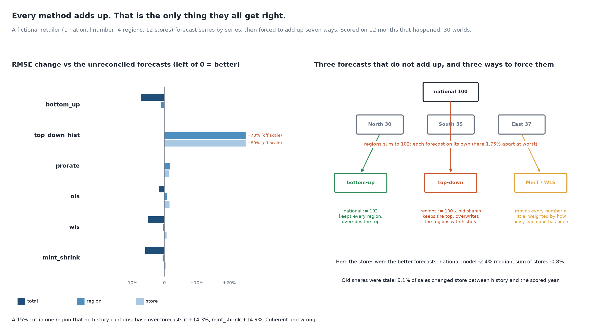

# The Regions Do Not Sum to the Forecast

[](https://colab.research.google.com/github/phoebefu6/phoebe-the-builder/blob/main/data-quality-governance/forecast-reconciliation/demo.ipynb)
[](https://mybinder.org/v2/gh/phoebefu6/phoebe-the-builder/main?labpath=data-quality-governance/forecast-reconciliation/demo.ipynb)

> The national forecast, the region forecasts and the store forecasts were each made on their own and do not add up, so someone forces them to match, and the check that it worked ("do the regions sum to the forecast?") passes even for the fix that doubles the region error.



## The short version

NOT a forecaster (`ts-forecaster`, Day 118) and NOT a backtest protocol (`forecast-backtest`, Day 172), and NOT a
roll-up of actuals (`hierarchy-reconciliation`, Day 210, rolls postings up a defective tree). This scores the step
after forecasting: making forecasts at three levels agree. A fictional retailer (1 national number, 4 regions,
12 stores; 48 months of history) has every series forecast on its own with a log-scale trend + month model, then
made coherent seven ways and scored against the 12 months that happened, in one seeded world (`Generator(211)`) and
30 more. Every number is in `evidence.txt`.

| method | adds up | total (30 worlds) | region | store | better at all 3 levels |
|---|:-:|---:|---:|---:|---:|
| `base` (each series on its own) | no | 0.0% | 0.0% | 0.0% | - |
| `bottom_up` (sum the stores) | yes | -7.2% | -0.9% | 0.0% | 0 / 30 |
| `top_down_hist` (split national by old shares) | yes | 0.0% | **+77.6%** | **+89.5%** | 0 / 30 |
| `prorate` (scale each level to the one above) | yes | 0.0% | +1.7% | +1.4% | 0 / 30 |
| `ols` | yes | -1.8% | +0.9% | +1.6% | 0 / 30 |
| `wls` (structural weights) | yes | -5.0% | -0.3% | +0.7% | 2 / 30 |
| `mint_shrink` | yes | -5.8% | -0.5% | +0.4% | 2 / 30 |

RMSE change vs the unreconciled forecasts; minus is better.

- **The gap comes from modelling, not from arithmetic.** The same linear model on every series adds up by
  construction (gap 0.00%). Fit on the log scale, as growth demands, and the regions miss the national forecast by
  up to 1.75%, the stores by 2.63%.
- **The coherence check passes for the worst method.** Splitting the national number by historical shares adds up
  exactly and doubles the region error in the seeded world (+102.6%), because 9.1% of sales moved between stores.
- **Bottom-up beat MinT at the top.** Lowest national error: bottom-up in 23 of 30 worlds. Stores grow at different
  rates, their sum is not one exponential, and the national log model under-forecasts (-2.4% median vs -0.8% for
  the summed stores). Which level to trust is a backtest question, not a textbook one.
- **Gains are a few percent, at the top.** WLS and MinT cut national RMSE 5-6% and give a little back at the stores;
  no method beats the unreconciled forecasts at all three levels in more than 2 of 30 worlds.

**Negative result:** reconciliation cannot add information. One region loses 15% of its sales in the scored year, a
cut no history contains. Every method over-forecasts it by about the same amount (base +14.3%, bottom-up +15.7%, WLS
+14.7%, MinT +14.9%, median of 30 worlds). The numbers add up and are all wrong; only a forecast input that knows
about the cut (a closure list, a sales-team override) fixes it.

**What to do:** never accept "the regions sum to the forecast" as evidence the plan is right; it is arithmetic.
Backtest each level's own forecast first and reconcile toward the level that forecasts best (bottom-up if the stores
win, WLS / MinT if no level dominates). Never split by historical shares when the mix is moving. Put known events in
as inputs; reconciliation will not find them.

## Business Impact
- **Before:** the planning pack does not add up, an analyst prorates the regions to the CFO's number, and regional
  targets inherit last year's mix.
- **After:** a scored comparison of seven ways to make the numbers agree, per level, on your own backtest.
- **Estimated ROI:** a few hours per planning cycle of manual reconciliation, and regional targets that are not off
  by the mix shift.

## Tech Stack
Python, numpy (least-squares reconciliation, shrinkage covariance), matplotlib, Streamlit, pytest, Docker.

## Demo

**[Run the interactive demo notebook →](demo.ipynb)** - pre-rendered with outputs, or click the Colab/Binder badges above to run it live.

For the Streamlit app (pick a method; see its region forecasts next to what happened):
```bash
pip install -r requirements.txt
python evidence.py && python make_chart.py   # writes results.json, evidence.txt, audit.png
streamlit run app.py
```

Files: `explore.py` (world, base forecasts, seven reconcilers, study), `evidence.py` (writes `evidence.txt`),
`make_chart.py` (figure with a geometry self-check), `build_notebook.py` (generates `demo.ipynb`), `test_*.py`.

## Learning Connection
Built while studying hierarchical forecasting (Hyndman and Athanasopoulos, *Forecasting: Principles and Practice*,
3rd ed., ch. 11; Wickramasuriya, Athanasopoulos and Hyndman 2019 on MinT).
Applies: the summing matrix, least-squares reconciliation as a projection, and Schafer-Strimmer covariance shrinkage.

## Impact Note
- **Who benefits:** FP&A and demand planners who own a forecast at several levels; data teams who build the
  planning pack.
- **Potential risks:** the retailer, growth rates and noise are invented, so which method wins here illustrates the
  mechanism, not your answer: run the comparison on your own backtest. A reconciled plan looks authoritative because
  it adds up; that is exactly why it can carry a stale mix or a missed event into every target below it.
