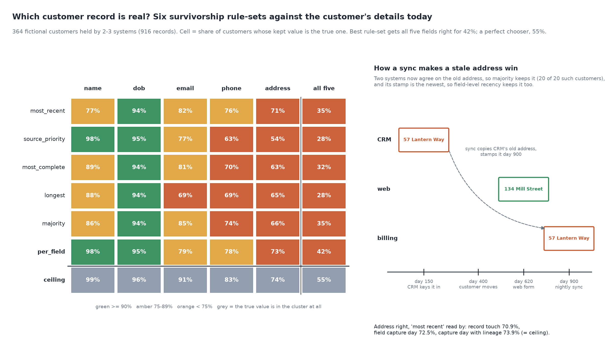

# Which Customer Record Is Real?

[](https://colab.research.google.com/github/phoebefu6/phoebe-the-builder/blob/main/data-quality-governance/golden-record/demo.ipynb)
[](https://mybinder.org/v2/gh/phoebefu6/phoebe-the-builder/main?labpath=data-quality-governance/golden-record/demo.ipynb)

> The same customer sits in CRM, billing and the web shop with three different addresses, and the golden record keeps whichever one your survivorship rule happens to prefer: the five usual rules agree on the whole record for only a third of customers, a nightly sync makes a stale address win the vote every time, and for 45% of customers no system holds today's value at all.



## The short version

NOT a merger: `dedup-pipeline` (Day 67) implements survivorship rules and merges clusters; `dedupe-key-choice`
(Day 205) scores which rows belong together. This scores the step in between: given a cluster, is the value each
rule keeps the TRUE one? That cannot be asked on real data, so the build makes 400 fictional customers whose
details change over time (35% move, 25% change phone, 15% change email) and lets three systems capture them the way
real systems do. 364 are held by two or more systems (916 records). Seeded `Random(208)`; every number below is in
`evidence.txt`.

| rule-set | name | dob | email | phone | address | all five right |
|---|---:|---:|---:|---:|---:|---:|
| `most_recent` (row `updated_at`) | 76.6% | 94.0% | 82.4% | 75.8% | 70.9% | 34.6% |
| `source_priority` (crm > billing > web) | **98.1%** | 95.1% | 76.9% | 62.6% | 54.4% | 27.7% |
| `most_complete` | 89.0% | 94.0% | 81.3% | 70.1% | 62.9% | 31.6% |
| `longest` | 87.6% | 94.0% | 69.2% | 69.0% | 64.8% | 27.7% |
| `majority` | 85.7% | 94.0% | **85.4%** | 74.5% | 66.5% | 35.2% |
| `per_field` (declared rule per field) | **98.1%** | 95.1% | 79.1% | **78.0%** | **72.5%** | **42.0%** |
| ceiling: the true value is in the cluster | 99.5% | 96.4% | 91.2% | 83.0% | 73.9% | 55.2% |

- **Every generic rule is right somewhere and wrong somewhere else.** Priority keeps CRM's legal name (98.1%) and
  CRM's oldest address (54.4%). Recency keeps the freshest address and the web form's nickname (76.6% on name).
- **The rule-set decides the record.** The five generic rule-sets keep the same golden record for 119 of 364
  customers; for 80 they produce three or four different ones from the same rows.
- **A sync turns a stale value into a fresh-looking majority.** In 30% of cases the nightly CRM -> billing sync
  overwrote billing's verified address with CRM's copy and stamped it with the sync day. In all 20 of the 20 clusters
  where that left two stale copies against one true web address, `majority` kept the stale one.
- **`updated_at` is a row timestamp.** An opt-in change bumps it without touching the address. Reading the field's
  own capture day lifts address from 70.9% to 72.5%; carrying the original capture day through the sync (lineage)
  lifts it to 73.9%, which is the ceiling.
- **A declared rule beats every generic one and still loses a field.** `per_field` gets 42.0% of customers fully
  right against 35.2% for the best generic rule, but trusting CRM for email loses to plain majority (79.1% vs
  85.4%): email changes, and CRM's copy is the oldest.

**Negative result (the ceiling):** for 163 of 364 customers (44.8%) at least one true value is held by no system:
they moved or changed phone after every capture. A perfect chooser would still get only 55.2% of customers fully
right. Survivorship chooses among the values you hold; for that half the fix is a fresh capture (ask the customer,
verify against a payment), not a better rule.

**What to do:** write the survivorship rule per field, not per record: trusted source for the stable fields (name,
date of birth), the field's own capture day for the volatile ones (phone, address), and measure email rather than
assume. Store a capture day per field and keep it through every sync; a sync that re-stamps a copied value is
manufacturing freshness. Before trusting a vote, check whether the voters are copies of each other. And route the
clusters where the rule-sets disagree to a steward or a re-verification, because that disagreement is where the
golden record is a choice, not a fact.

## Business Impact
- **Before:** one survivorship rule chosen in an MDM workshop, applied to every field, never scored; the mailing
  goes to the old address and nobody can say how often.
- **After:** per-field rules chosen by measured accuracy, a disagreement report that names the fields a steward must
  check, and a count of customers whose true details are in no system at all.
- **Estimated ROI:** a few hours of rule design per domain; every point of address accuracy is returned mail and
  failed deliveries avoided.

## Tech Stack
Python standard library (random, collections), matplotlib, Streamlit, pytest, Docker.

## Demo

**[Run the interactive demo notebook →](demo.ipynb)** - pre-rendered with outputs, or click the Colab/Binder badges above to run it live.

For the Streamlit app (paste one customer's records from several systems; see the golden record each of the six
rule-sets keeps and which fields they disagree on):
```bash
pip install -r requirements.txt
python evidence.py && python make_chart.py   # writes results.json, evidence.txt, audit.png
streamlit run app.py
```

Files: `explore.py` (world, rules, study), `evidence.py` (writes `evidence.txt`), `make_chart.py` (figure with a
geometry self-check), `build_notebook.py` (generates `demo.ipynb`), `test_*.py`.

## Learning Connection
Built while studying data governance for the CDAIO track (master data management, survivorship and data lineage).
Applies: scoring survivorship rules field by field against a known truth, and separating what a rule can fix from
what only a fresh capture can.

## Impact Note
- **Who benefits:** MDM and CRM teams choosing survivorship rules; data stewards deciding which merged records to
  review first.
- **Potential risks:** the systems, error rates and change rates are invented to be plausible, so the ranking of
  rules here is an illustration of the mechanism, not a recommendation for your data: score your own rules on a
  sample you have re-verified. The app shows disagreement, not truth; a field where all six rules agree can still be
  wrong if every system holds the same stale value.
