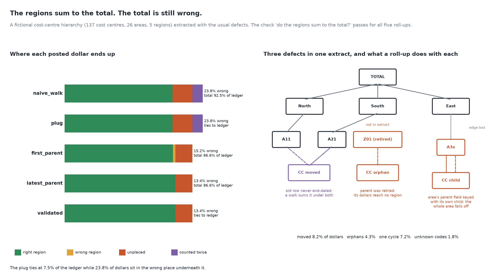

# The Regions Do Not Sum to the Total

[](https://colab.research.google.com/github/phoebefu6/phoebe-the-builder/blob/main/data-quality-governance/hierarchy-reconciliation/demo.ipynb)
[](https://mybinder.org/v2/gh/phoebefu6/phoebe-the-builder/main?labpath=data-quality-governance/hierarchy-reconciliation/demo.ipynb)

> The cost report by region does not tie to the ledger, or it ties and the regions are still wrong, because the org hierarchy it rolls up through has moved cost centres listed under two parents, orphans whose area was retired, and one mis-keyed parent that cut a whole area off the tree, and the check everyone runs ("do the regions sum to the total?") passes either way.



## The short version

NOT a source-to-target row reconciler (`reconciliation-checker`, Day 99, compares two systems) and NOT a KPI driver
tree (`kpi-tree`, Day 107, decomposes a metric). This scores the step in between: rolling postings up a parent-child
hierarchy that arrived with defects. A fictional organisation of 5 regions, 26 areas and 137 cost centres posts 1,687
costs (ledger 14,415,445). The extract keeps the old row for 12 moved cost centres, holds 6 orphans whose parent area
was retired, has one area whose parent field was keyed with its own child (a cycle), and misses 4 new cost centres
that already post; 2.4% of dollars are posted at area level. Seeded `Random(210)`; every number is in `evidence.txt`.

| roll-up | regions = total | total = ledger | right region | wrong region | unplaced | counted twice |
|---|:-:|:-:|---:|---:|---:|---:|
| `naive_walk` (every edge, leaf postings) | yes | no (92.5%) | 84.4% | 0.0% | 15.6% | 8.2% |
| `plug` (naive + "Other") | yes | yes | 84.4% | 0.0% | 15.6% | 8.2% |
| `first_parent` (first row in file) | yes | no (86.6%) | 84.8% | 1.8% | 13.4% | 0.0% |
| `latest_parent` (latest load) | yes | no (86.6%) | 86.6% | 0.0% | 13.4% | 0.0% |
| `validated` (+ named Unassigned bucket) | yes | **yes** | 86.6% | 0.0% | 13.4% (named) | 0.0% |

- **The check everyone runs never fires.** "Regions sum to the total" passes for all five, because the total is
  built by the same roll-up. It proves the report agrees with itself; only tying to the ledger tests it.
- **A recursive walk counts moves twice and drops everything off the tree.** 8.2% of dollars twice; orphans, the
  cycle, unknown codes and area-level postings (15.6%) nowhere.
- **The plug hides a gross error several times its size.** The "Other" line is 7.5% of the ledger; 23.8% of dollars
  are in the wrong place under it (3.2x). Across 30 seeds the ratio's median is 5.0x, never below 2.5x.
- **File order is not a rule.** Keeping the first parent row puts 4 of 12 moves under their old area. The latest load
  gets all 12 here, but only because this simulation always loads the new row later: check what your load stamp means.

**Negative result:** after validation the total ties and every unplaced dollar is named by defect, yet 13.4% of the
ledger is still unplaced and no region is within 0.5% of the truth. One mis-keyed parent field alone accounts for
7.2%. Across 30 seeds the unplaced share runs from 5.8% to 14.1%. The extract does not say where an orphan's retired
area went or what the looping area's parent should be, so no roll-up rule can place it: only a fix in the source
hierarchy does.

**What to do:** validate the hierarchy before rolling up (one parent per child, every parent present, no loops, every
posted code present). Never ship "regions sum to total" as the reconciliation; tie the roll-up to the ledger. Replace a
plug with a named Unassigned bucket broken down by defect, and send that list to the hierarchy owner. End-date moved
rows in the source, with an effective date, so "latest" is a fact rather than a load-order accident.

## Business Impact
- **Before:** the regional cost pack does not tie, an analyst plugs the gap to "Other", and a region's budget review
  runs on numbers that are a fifth wrong.
- **After:** four validation checks on the extract, a roll-up that ties to the ledger, and a named list of the cost
  centres the hierarchy owner has to fix.
- **Estimated ROI:** a few hours per month-end close of hunting a variance by hand, and one board-level restatement
  avoided.

## Tech Stack
Python standard library (random, collections), matplotlib, Streamlit, pytest, Docker.

## Demo

**[Run the interactive demo notebook →](demo.ipynb)** - pre-rendered with outputs, or click the Colab/Binder badges above to run it live.

For the Streamlit app (pick a roll-up; see its region totals next to the truth and where the dollars went):
```bash
pip install -r requirements.txt
python evidence.py && python make_chart.py   # writes results.json, evidence.txt, audit.png
streamlit run app.py
```

Files: `explore.py` (world, extract, roll-ups, validator, study), `evidence.py` (writes `evidence.txt`),
`make_chart.py` (figure with a geometry self-check), `build_notebook.py` (generates `demo.ipynb`), `test_*.py`.

## Learning Connection
Built while studying data governance for the CDAIO track (master and reference data management, hierarchy
management for financial reporting).
Applies: scoring roll-up strategies per posted dollar, and separating what validation can name from what only a fix
in the source hierarchy can place.

## Impact Note
- **Who benefits:** FP&A and controllers who close the month on a regional pack; data stewards who own org, cost-centre
  and product hierarchies.
- **Potential risks:** the hierarchy, defect counts and amounts are invented to be plausible, so the percentages
  illustrate the mechanism, not your exposure: run the four checks on your own extract. An Unassigned bucket is a
  disclosure, not a fix; reporting it and leaving it there for months is the plug under a better name.
