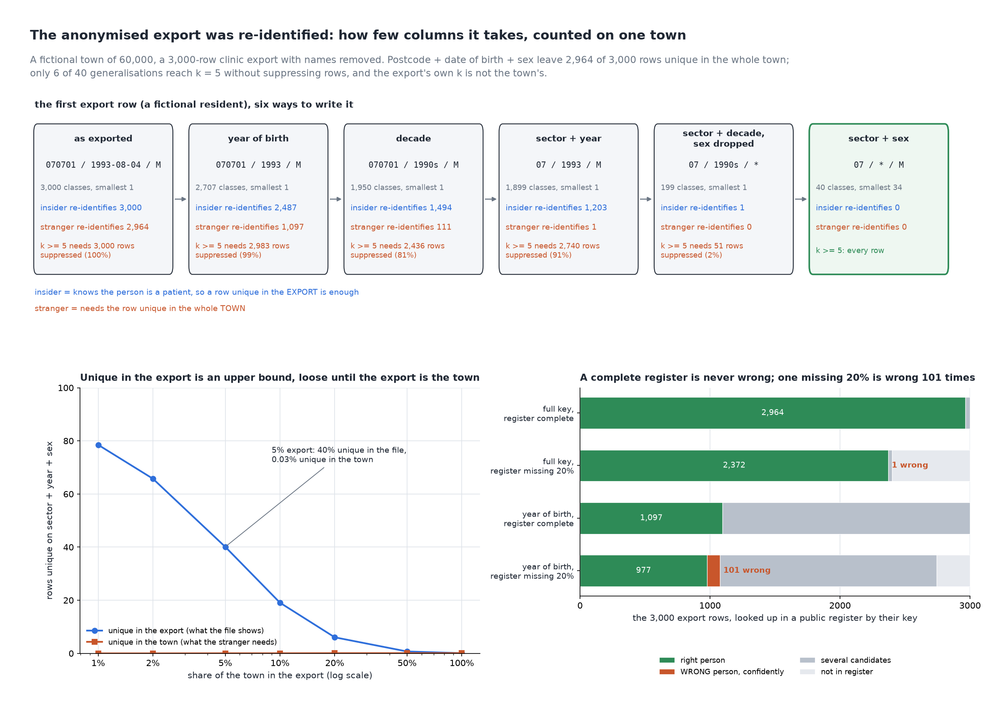

# The Anonymised Export Was Re-identified

[](https://colab.research.google.com/github/phoebefu6/phoebe-the-builder/blob/main/data-quality-governance/k-anonymity-check/demo.ipynb)
[](https://mybinder.org/v2/gh/phoebefu6/phoebe-the-builder/main?labpath=data-quality-governance/k-anonymity-check/demo.ipynb)

> The names were removed and the export still points at one person: in a town of 60,000, postcode plus date of birth make 2,932 of 3,000 exported residents the only person in town with that pair, only 6 of 40 ways of coarsening the columns reach k = 5 without suppressing rows, "unique in the export" overstates "unique in the town" a thousandfold at a coarse key and not at all at a fine one, and a linkage register missing a fifth of the town names the wrong person, confidently, 101 times.



## The short version

NOT a redactor: `pii-redactor` (Day 124) and `pii-detector` (Day 5) find and mask the direct identifiers. This
measures what is left after they are done. A fictional town of 60,000 residents in 600 postcodes (15 to 4,438
people each, a tower block and a terrace), an age pyramid, a skewed diagnosis mix; a 3,000-row clinic export of
it with names removed and three quasi-identifiers kept: postcode, date of birth, sex. Everything is seeded
(`Random(206)`), every resident is fictional, every number below is in `evidence.txt`.

| columns kept, full detail | unique in the export | unique in the town |
|---|---:|---:|
| postcode | 114 | 0 |
| date of birth | 2,687 | 498 |
| sex | 0 | 0 |
| postcode + date of birth | 2,994 | **2,932** |
| postcode + date of birth + sex | 3,000 | 2,964 |

- **Two columns do it.** No postcode and no sex makes anyone unique on its own; a date of birth alone already makes
  498 exported residents the only person in town born that day. Postcode + date of birth make 97.7% of the export
  unique in the whole town. The third column added 32 rows; the second added 2,434.
- **The ladder is steep.** Year of birth with the full postcode still leaves 2,487 export rows unique and 1,097
  unique in the town; the decade still leaves 111. Of 40 generalisations, 6 reach k = 5 in the export without
  suppressing a row, and all 6 drop the date of birth or cut the postcode to its sector; the finest is sector +
  sex, 40 classes. Allowing 5% suppression, the finest is sector + decade with sex dropped: 199 classes, 51 rows
  suppressed.
- **Unique in the export is not unique in the town.** At sector + year + sex, 40.1% of export rows are unique in
  the export and 0.03% (one row) in the town. The export's own count is an upper bound, loose until the export is
  most of the town, tight at a fine key (100% vs 98.8%). Which bound matters depends on who is looking: an insider
  who knows the person is a patient needs only the export and re-identifies 1,203; a stranger needs the town and
  re-identifies 1.
- **The register that is wrong.** A complete public register (name + the three columns) re-identifies exactly the
  town-unique rows, 2,964, and is never wrong. Missing 20% of the town, at year of birth it is right 977 times and
  wrong 101 times, each a confident match to a different resident who happens to share the key, because the right
  one is not in the register; at sector + year it is wrong more often than right (4 vs 3).
- **k does not protect the value.** The diagnosis column is not a quasi-identifier, so k never looks at it. In the
  199-class release no class is homogeneous, but 31 rows sit in classes where one diagnosis is at least 80% of the
  class, and 10 of the 40 generalisations yield a k = 5 release in which placing a person in their class makes an
  attacker at least 50% sure of a sensitive diagnosis, against a baseline of 11.7%.

**Negative result (the ceiling):** the export's k is not the town's k, and the town is not in the file. At
sector + year + sex the export has 2,740 rows below k = 5; the town has 52. Neither column can be read off the
other, so a k measured on the export is a statement about insiders, and the stranger's risk needs a population
model the release team does not hold. And a six-digit postcode that holds 15 residents cannot hide anyone,
whatever is done to the other columns.

**What to do:** decide which attacker you are defending against before choosing k. For an insider, k on the export
is the right number and it is brutal: here it costs the date of birth. For a stranger, estimate population
uniqueness (a census marginal, a register you hold, or a model) rather than reading the export's. Count the share of
each class's commonest sensitive value before release, since k says nothing about it. And treat a linkage test with
an incomplete register as a test that produces wrong answers with confidence, not just fewer right ones.

## Business Impact
- **Before:** an export was called "anonymised" because the name and ID columns were dropped, and nobody counted how
  many rows the remaining columns still singled out.
- **After:** every column subset and every generalisation scored by rows unique in the file and rows unique in the
  population, the two attackers named, and the suppression cost of each k = 5 release stated.
- **Estimated ROI:** one counted table replaces a judgement call per data-sharing request; the first time it says
  97.7% of rows are unique it also prevents a reportable breach.

## Tech Stack
Python standard library (the town, the ladder, the linkage), matplotlib, Streamlit, pytest, Docker.

## Demo

**[Run the interactive demo notebook →](demo.ipynb)** — pre-rendered with outputs, or click the Colab/Binder badges above to run it live.

For the Streamlit app (paste your own export's postcode, date of birth and sex columns; pick a generalisation and k;
see the classes, the smallest class, the unique rows and the rows below k):
```bash
pip install -r requirements.txt
python evidence.py && python make_chart.py   # writes results.json, evidence.txt, audit.png
streamlit run app.py
```

Files: `explore.py` (town, export, ladder, sweep, linkage, disclosure), `evidence.py` (writes `evidence.txt`),
`make_chart.py` (figure with a geometry self-check), `build_notebook.py` (generates `demo.ipynb`), `test_*.py`.

## Learning Connection
Built while studying data governance and privacy for the CDAIO track (Sweeney's k-anonymity and the 87% result,
l-diversity, population versus sample uniqueness, record linkage).
Applies: measuring re-identification risk by counting equivalence classes in the file and in the population it was
drawn from, and separating the insider's bound from the stranger's.

## Impact Note
- **Who benefits:** data-sharing, research-data and governance teams releasing row-level extracts; anyone asked to
  sign off that an export is "anonymised".
- **Potential risks:** the town is fictional and its geography is one choice of skew; real postcodes, registers and
  age pyramids will move every number. k = 5 is a convention, not a law; a regulator or contract may set another.
  The linkage attack here uses one register; a real attacker has several, and voter rolls, social profiles and
  breached datasets each add a column this study does not model.
