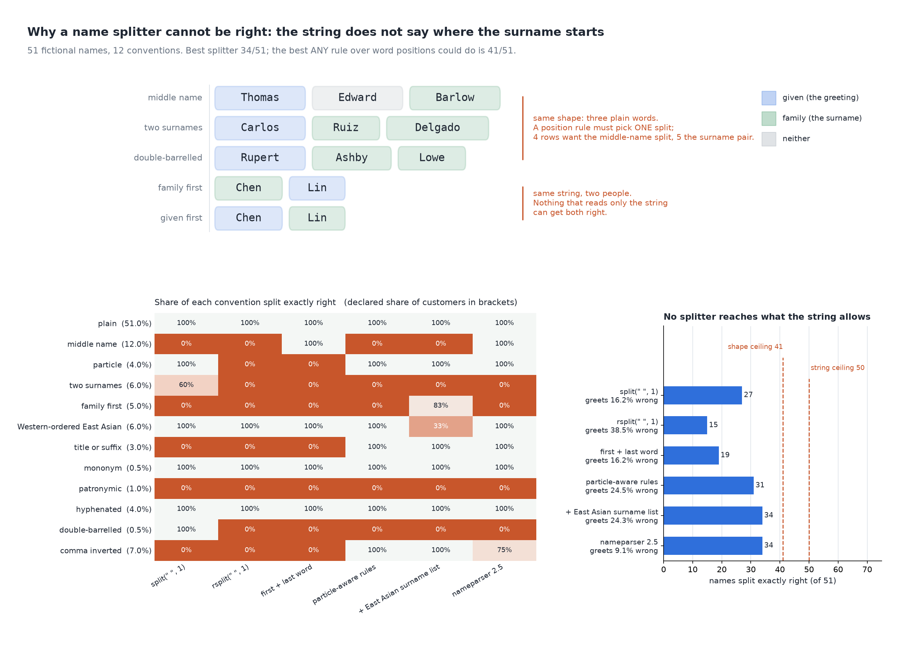

# First Name Came Out as Van

[](https://colab.research.google.com/github/phoebefu6/phoebe-the-builder/blob/main/data-quality-governance/name-splitter/demo.ipynb)
[](https://mybinder.org/v2/gh/phoebefu6/phoebe-the-builder/main?labpath=data-quality-governance/name-splitter/demo.ipynb)

> The welcome email said "Dear van" because the import script split a full name on the first space, and no rule can fix it reliably: the string does not say where the surname starts. Six splitters against twelve naming conventions show who each one gets wrong, and where the ceiling is.



## The short version

51 fictional full names in 12 naming conventions (plain, middle names, particles, Iberian two surnames,
family-first, Western-ordered East Asian, titles and suffixes, mononyms, Malay patronymics, hyphenated,
double-barrelled, comma-inverted exports). Truth is hand-labelled per row: **given** = the name you greet them by,
**family** = the surname as filed, particles included, empty where the convention has none. Nothing is random.

| splitter | both right (of 51) | given wrong | family wrong | customers greeted wrong* |
|---|---:|---:|---:|---:|
| `split(" ", 1)` | 27 | 15 | 24 | 16.20% |
| `rsplit(" ", 1)` | 15 | 36 | 30 | **38.50%** |
| first + last word (spreadsheet formula) | 19 | 15 | 30 | 16.20% |
| particle-aware rules | 31 | 20 | 16 | 24.50% |
| + East Asian surname list | 34 | 17 | 13 | 24.33% |
| `nameparser` 2.5 | 34 | 9 | 16 | 9.15% |

\* Declared assumption, not data: 51% plain, 12% middle names, 7% comma-inverted exports, and so on (`SHARE` in
`explore.py`; the app lets you set your own mix).

- **"Dear van" and "Dear Dr." are real outputs.** `split(" ", 1)` greets `van den Broek, Pieter` as "van" and every
  titled customer as their title; `rsplit` greets Pieter as "Pieter van den".
- **The library wins and is still wrong a third of the time.** nameparser greets the fewest wrong (9.15%) and files
  16 of 51 surnames wrong: every Iberian second surname, every family-first name, every patronymic.
- **Patching rules trades groups.** A list of East Asian surnames lifts family-first names from 0% to 83% and drops
  names already written in Western order from 100% to 33%. Same total, different people hurt.
- **Six names defeat every splitter:** two Iberian double given names, a Hungarian family-first name, and three
  Malay patronymics, where `bin Ahmad` is the father, not a surname.

**Negative result (the ceiling):** `Chen Lin` appears twice with two truths, so nothing that reads only the string
can exceed 50/51. A rule over word positions cannot tell `Thomas Edward Barlow` (middle name) from `Rupert Ashby
Lowe` (two-word surname): 41/51 is its maximum. The best splitter here gets 34.

**What to do:** stop splitting. Capture given and family in separate fields (plus "what should we call you"), and
keep the full name as typed. For a legacy column, use a maintained library and route the conventions it fails
(table above) to a human, not a rule.

## Business Impact
- **Before:** mail-merge greetings like "Dear van", surname-sorted lists filed under "Lopez" for Ana María Pérez López.
- **After:** each splitter's failures named by convention and priced against your own customer mix.
- **Estimated ROI:** a one-liner `rsplit` to a library cuts wrong greetings from ~38% to ~9% under the declared mix;
  separate fields cut it to zero.

## Tech Stack
Python, nameparser, matplotlib, Streamlit, pytest, Docker.

## Demo

**[Run the interactive demo notebook →](demo.ipynb)** — pre-rendered with outputs, or click the Colab/Binder badges above to run it live.

For the Streamlit app (paste your own names, set your own customer mix):
```bash
pip install -r requirements.txt
python evidence.py && python make_chart.py   # writes results.json, evidence.txt, audit.png
streamlit run app.py
```

Files: `explore.py` (corpus, splitters, ceilings), `evidence.py` (writes `evidence.txt`), `make_chart.py` (figure
with a geometry self-check), `build_notebook.py` (generates `demo.ipynb`), `test_*.py`.

## Learning Connection
Built while studying data quality and governance for the CDAIO track (W3C, "Personal names around the world").
Applies: measuring a parser against labelled conventions, and computing what the input itself makes impossible.

## Impact Note
- **Who benefits:** CRM, marketing-ops and data teams who own a customer table with one full-name column.
- **Potential risks:** the corpus is 51 fictional names chosen to cover each convention, not a sample of a real
  table; the mix is an assumption. The truth labels follow one reading of each convention, and people within a
  convention differ: ask them.
