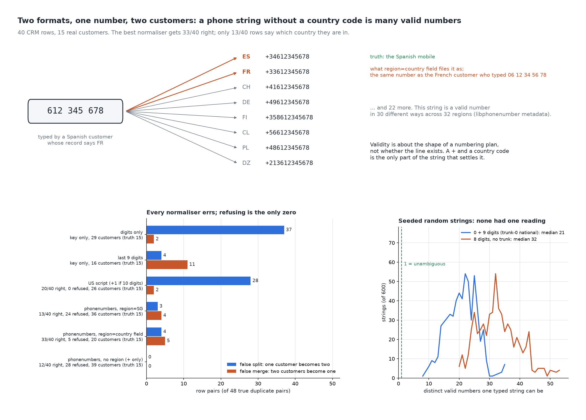

# Two Formats, One Number, Two Customers

[](https://colab.research.google.com/github/phoebefu6/phoebe-the-builder/blob/main/data-quality-governance/phone-normaliser/demo.ipynb)
[](https://mybinder.org/v2/gh/phoebefu6/phoebe-the-builder/main?labpath=data-quality-governance/phone-normaliser/demo.ipynb)

> The same customer typed their number two ways and became two customers, while a Spanish customer with a French address was filed under a French customer's number. A phone string with no country code is not one number: the digits 612 345 678 are a valid number in 30 different ways, and the record's country field is usually the shipping address.



## The short version

40 fictional CRM rows belonging to 15 real customers, each labelled with its true E.164 number. Every number is a
fictional or documentation range (Ofcom drama numbers, NANP 555-01xx, ACMA 0491 570 1xx, libphonenumber's examples).
Six normalisers turn the typed string into a match key; the only randomness is a seeded sweep.

| normaliser | E.164 right | refused | false splits (of 48) | false merges | customers (truth 15) |
|---|---:|---:|---:|---:|---:|
| `re.sub(r"\D", "", phone)` | key only | 0 | 37 | 2 | 29 |
| last 9 digits | key only | 0 | 4 | **11** | 16 |
| US script (+1 if 10 digits) | 20/40 | 0 | 28 | 2 | 26 |
| phonenumbers, region = SG (the HQ) | 13/40 | 24 | 3 | 4 | 36 |
| phonenumbers, region = country field | **33/40** | 5 | 4 | 5 | 20 |
| phonenumbers, no region (+ only) | 12/40 | 28 | **0** | **0** | 39 |

- **Digits-only splits almost everyone.** 37 of 48 true duplicate pairs stay apart because `020...` and `+44 20...`
  are different digit strings.
- **The usual fix trades splits for merges.** Matching the last 9 digits joins the French and Spanish customers
  (`06 12 34 56 78` vs `612 345 678`) and the Singapore and Hong Kong ones (`9123 4567` is a valid mobile in both):
  11 pairs of different people become one.
- **The library is right most often and still wrong silently.** With the record's country field it gets 33/40, and
  files the Spanish customer at `+33 6 12 34 56 78`: a valid number, someone else's. Under a Singapore default,
  `0033612345678` becomes a Hungarian number, because `00` is not the international prefix everywhere.
- **Refusing is the only zero.** Parsing with no region makes no errors and refuses 28 of 40 rows.

**Negative result (the ceiling):** in a seeded sweep of 600 random strings typed without a country code, none had a
single valid reading; the median trunk-0 string is 21 valid numbers across 245 regions. Only 13/40 rows say which
number they are; adding the country field lifts the bound to 39/40 and no further, because `9123 4567` on a
Singapore-address record is a Singapore customer in one row and a Hong Kong customer in another. And "valid" means
the numbering plan allows that shape, not that the line is in service.

**What to do:** store E.164 with a `+` at capture (a country picker beside the field, prefilled, editable). For a
legacy column, parse with the country field, but match only on numbers whose string carried its own country code,
and send the rest to a human or an SMS confirmation instead of a default region.

## Business Impact
- **Before:** duplicate customer records from formatting, and merged records (shared consent, shared order history)
  from a "last 9 digits" key nobody priced.
- **After:** each key's false splits and false merges counted against a labelled table, and the ambiguous rows named.
- **Estimated ROI:** moving from digits-only to the library cuts false splits from 37 to 4 of 48 pairs; refusing
  ambiguous rows removes merges at the cost of a review queue sized here at 28 of 40.

## Tech Stack
Python, phonenumbers (libphonenumber metadata), matplotlib, Streamlit, pytest, Docker.

## Demo

**[Run the interactive demo notebook →](demo.ipynb)** — pre-rendered with outputs, or click the Colab/Binder badges above to run it live.

For the Streamlit app (paste your own rows, set your own default region):
```bash
pip install -r requirements.txt
python evidence.py && python make_chart.py   # writes results.json, evidence.txt, audit.png
streamlit run app.py
```

Files: `explore.py` (corpus, normalisers, readings, ceiling, sweep), `evidence.py` (writes `evidence.txt`),
`make_chart.py` (figure with a geometry self-check), `build_notebook.py` (generates `demo.ipynb`), `test_*.py`.

## Learning Connection
Built while studying data quality and governance for the CDAIO track (ITU-T E.164, Google libphonenumber).
Applies: measuring a match key by false splits and false merges, and computing what the input cannot settle.

## Impact Note
- **Who benefits:** CRM, marketing-ops and data teams deduplicating customers or sending SMS from a free-text phone
  column.
- **Potential risks:** 40 rows chosen to cover each failure, not a sample of a real table. libphonenumber validity is
  metadata, not a carrier lookup; a merge decided on a phone number can also merge consent, so a wrong one is a
  privacy incident, not just a duplicate.
