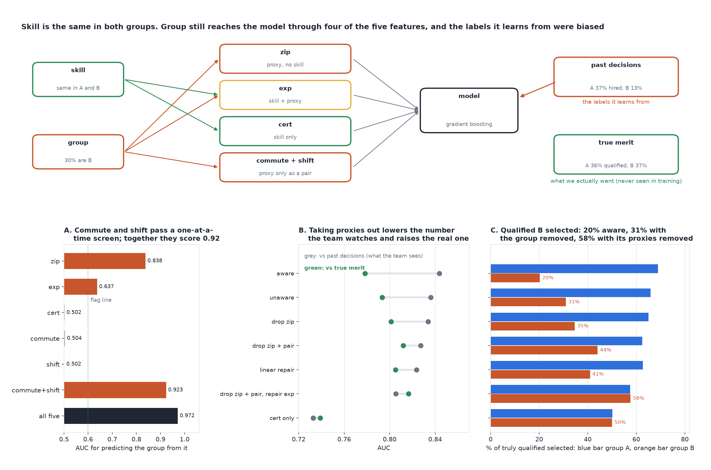

# We Removed the Attribute and It Still Discriminates

[](https://colab.research.google.com/github/phoebefu6/phoebe-the-builder/blob/main/data-quality-governance/proxy-variable-finder/demo.ipynb)
[](https://mybinder.org/v2/gh/phoebefu6/phoebe-the-builder/main?labpath=data-quality-governance/proxy-variable-finder/demo.ipynb)

> We took group out of the model. It still selects that group at well under half the rate of everyone else, two of the features that carry it pass our proxy check, and the fix that worked made our accuracy dashboard go down.



## The short version

Two groups of applicants have the same distribution of true skill: the skill gap is 0.002 standard deviations and
36% of each group is truly qualified. Past hiring decisions, which are the training labels, selected 36.6% of group A
and 13.0% of group B. Five features reach the model:

| feature | carries skill | tied to group | what it is |
|---|---|---|---|
| `zip` | no | strongly | neighbourhood index, a classic proxy |
| `exp` | yes | partly | years of experience, depressed for B by historical access |
| `cert` | yes | no | certification score |
| `commute`, `shift` | no | only as a pair | B's shift sign follows its commute sign; A's opposes it |

Every model is a real scikit-learn gradient-boosting fit, trained on the biased history, selecting the top 30%, and
judged against the history (what the team can measure) and against true skill (what they want). Everything runs on
three seeds; the min-max spread is reported. `disparate-impact` measures the gap and why fairness definitions
conflict. This build finds where the gap gets in when the attribute is not even an input.

| model | B/A selection ratio | AUC vs past decisions | AUC vs true skill | qualified B selected |
|---|---:|---:|---:|---:|
| aware (group as a feature) | 0.218 | 0.844 | 0.778 | 20.3% |
| unaware (group removed) | 0.385 | 0.836 | 0.793 | 31.0% |
| drop zip | 0.450 (0.37-0.53) | 0.834 | 0.801 | 34.6% |
| drop zip + the pair | 0.639 | 0.827 | 0.812 | 44.1% |
| linear repair of every feature | 0.582 | 0.824 | 0.805 | 40.9% |
| **drop zip + pair, repair exp** | **1.012** | **0.805** | **0.817** | **57.6%** |
| cert only | 1.002 | 0.733 | 0.739 | 50.0% |

## What it found

1. **Removing the attribute is not enough.** The unaware model selects B at 0.385 of A's rate. All five features
   together predict group at an AUC of 0.972, so the model reconstructs what was removed.
2. **The one-feature screen misses a joint proxy.** `commute` and `shift` each predict group at 0.50, pure noise, and
   pass. Together they predict it at 0.923.
3. **Drop-one importance hides the obvious proxy.** Removing `zip` from the joint group model costs only 0.030 of
   AUC, against 0.120 for `shift`. That is not because `zip` is weak (0.838 alone) but because the pair can stand in
   for it. Redundant proxies protect each other.
4. **Linear repair cannot reach an interaction.** Subtracting each feature's group mean reaches a ratio of 0.582:
   the pair has the same mean in both groups, so the repair never touches it.
5. **The fix that works lowers the number the team watches.** Dropping `zip` and the pair and repairing `exp` reaches
   parity (1.012, between 1.00 and 1.03 across seeds) and leaves no trace of group in the score (AUC 0.502). AUC
   against past decisions falls from 0.844 to 0.805. AUC against true skill rises from 0.778 to 0.817. The old model
   was being rewarded for reproducing the old bias.
6. **Negative result.** Dropping `zip` alone is unstable: its ratio ranges from 0.37 to 0.53 across seeds, depending
   on how fully the model picks up the pair instead. And `cert` alone is perfectly fair and much less accurate (0.739):
   fairness by throwing away signal is a real option with a real price.

Full output in [evidence.txt](evidence.txt).

## Business Impact
- **Before:** the protected attribute is dropped, each feature is checked for correlation with it, the model ships,
  and accuracy against historical decisions is the release gate.
- **After:** proxies are screened in pairs and jointly, removals and repairs are compared on parity and on accuracy
  against the outcome that matters, and the historical-label metric is read as a measure of bias reproduction.
- **Estimated ROI:** a screening model that holds up to a disparate-impact audit, and selects more of the truly
  qualified (AUC 0.778 to 0.817 against true skill in this world).

## Tech Stack
Python, scikit-learn (gradient boosting), NumPy, Matplotlib, Streamlit, pytest, Docker.

## Demo

**[Run the interactive demo notebook →](demo.ipynb)** - pre-rendered with outputs, or click the Colab/Binder badges above to run it live.

For the Streamlit app (set how strong each proxy is and how biased the history was):
```bash
pip install -r requirements.txt
python evidence.py && python make_chart.py
streamlit run app.py
```

## Files
- `proxy.py` - the engine: the world, three proxy screens, seven models, the multi-seed study
- `evidence.py` - runs the study, writes `results.json` and `evidence.txt`
- `make_chart.py` - the audit figure, with a geometry self-check before saving
- `build_notebook.py` - generates `demo.ipynb` with the engine extracted from `proxy.py`
- `test_proxy.py`, `test_notebook.py`, `test_app.py` - 26 tests

## Learning Connection
Built while studying *Fairness and Machine Learning* (Barocas, Hardt and Narayanan) on why fairness through unawareness
fails, and Feldman et al. (2015), "Certifying and removing disparate impact", on repairing features. Applies: proxy
detection, interaction effects, redundancy in feature importance, and evaluating against an unbiased target.

## Impact Note
- **Who benefits:** teams building screening, lending or pricing models, and the auditors who review them.
- **Potential risks:** in this world true skill is known, so the trade-off is visible; in practice the unbiased
  target is rarely available and must be estimated or argued for. Using the protected attribute to repair features
  may itself be restricted by law in some settings. A clean screen is evidence about the proxies you tested, not
  about the ones you did not think to combine.
