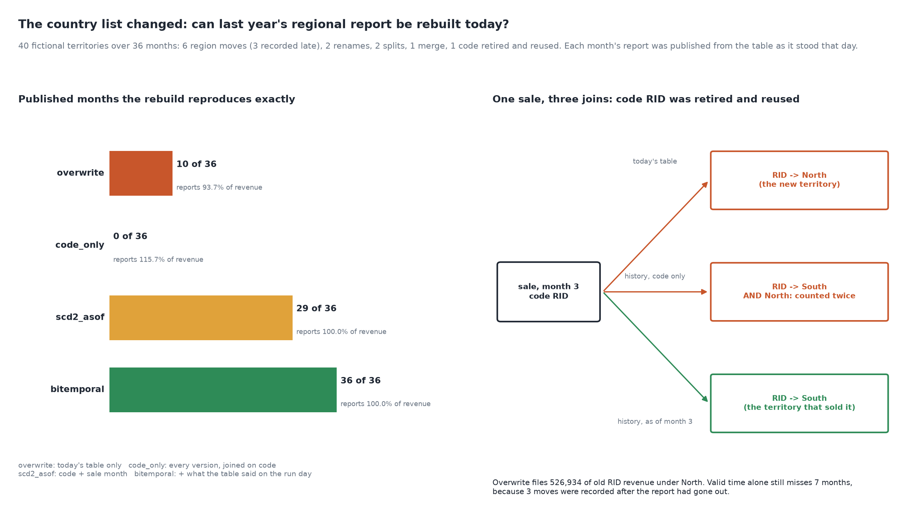

# The Country List Changed

[](https://colab.research.google.com/github/phoebefu6/phoebe-the-builder/blob/main/data-quality-governance/reference-data-versioning/demo.ipynb)
[](https://mybinder.org/v2/gh/phoebefu6/phoebe-the-builder/main?labpath=data-quality-governance/reference-data-versioning/demo.ipynb)

> Last year's revenue by region no longer matches the report that went out, because the territory list changed underneath it: joining to today's list loses 6% of revenue and files a retired code's history under the territory that reused it, joining the history on the code alone over-counts revenue by 16%, and even a proper as-of join rewrites 7 of 36 months because three changes were keyed in late.



## The short version

NOT a snapshot differ (`data-diff`, Day 100, compares two datasets) and NOT a golden record (`golden-record`, Day 208,
picks a value among systems). This scores the step that makes a historical report reproducible or not: how a
fact table is joined to a reference list that keeps changing. 40 fictional territories in 5 regions over 36 months:
6 region moves (3 recorded 2-4 months after they took effect), 2 renames, 2 splits, 1 merge, and 1 code retired
(territory absorbed) and later reused for a new territory in another region. 1,481 monthly sales facts carry the
code valid on the day of the sale. Each month a regional report was published from the table as known that day.
Seeded `Random(209)`; every number below is in `evidence.txt`.

| rebuild strategy | months reproduced (of 36) | revenue reported | dropped by the join |
|---|---:|---:|---:|
| `overwrite` (today's table only) | 10 | 93.7% | 6.3% |
| `code_only` (full history, joined on code) | 0 | 115.7% | 0.0% |
| `scd2_asof` (code + sale month) | 29 | 100.0% | 0.0% |
| `bitemporal` (+ what the table said on the run day) | **36** | 100.0% | 0.0% |

- **Today's table drops what was renamed, split or merged away** (6.3% of revenue finds no row) and silently
  files the reused code's old history (526,934) under the new territory's region. Nothing errors.
- **A history joined on code alone fans out.** Every code that ever changed matches several versions, so the
  report shows 115.7% of revenue and reproduces no month.
- **Valid time is not enough.** The as-of join gets every dollar and still rewrites 7 of 36 published months
  (15 cells), because three moves were keyed in after the report had gone out. A recorded-time axis fixes it at 57
  rows; a monthly snapshot of the whole table does too, at 1,445.
- **As-was and as-is are two right answers.** Restating every past sale to today's regions is what a trend needs;
  it differs from what was reported in 119 of 180 cells. The failure is a number that does not say which it is.

**Negative result (the split):** to restate a split territory, every old sale must go to one of the two halves, and
the sale never recorded which. A 50/50 rule puts 10.2% of that revenue in the wrong region; using each half's share
after the split does worse (20.5%), because the mix drifted before the split - true here by construction, and the
usual reason a territory is split at all. Across 30 seeds the drift-share rule lost to 50/50 every time. No rule over
the reference data recovers it; only capturing the finer location on the sale does.

**What to do:** never overwrite reference rows - version them with `valid_from`/`valid_to` and join on the sale
date. Add the month each row was recorded, so "what did we report" and "what was true" are both answerable. Never
reuse a retired code; if the upstream list does, key on a surrogate. Carry lineage (`replaced_by`) for renames,
merges and absorbs. Label every historical report as-was or as-is. And capture the finest location you can on the
transaction, because a split is the one change no reference table can undo.

## Business Impact
- **Before:** the regional history is re-pulled from today's list, the totals do not tie to the board pack, and an
  analyst spends days explaining the gap by hand.
- **After:** a bitemporal reference table that reproduces every published month exactly, an explicit as-is view for
  trends, and a list of the splits whose history is an allocation, not a fact.
- **Estimated ROI:** one schema change to the reference table; each avoided "why does this not match" investigation
  is a day of analyst time and a restated board number.

## Tech Stack
Python standard library (random, collections), matplotlib, Streamlit, pytest, Docker.

## Demo

**[Run the interactive demo notebook →](demo.ipynb)** - pre-rendered with outputs, or click the Colab/Binder badges above to run it live.

For the Streamlit app (pick a month; see the published report next to the four rebuilds and the as-is restatement):
```bash
pip install -r requirements.txt
python evidence.py && python make_chart.py   # writes results.json, evidence.txt, audit.png
streamlit run app.py
```

Files: `explore.py` (world, reference table, joins, study), `evidence.py` (writes `evidence.txt`), `make_chart.py`
(figure with a geometry self-check), `build_notebook.py` (generates `demo.ipynb`), `test_*.py`.

## Learning Connection
Built while studying data governance for the CDAIO track (reference and master data management, slowly changing
dimensions and bitemporal modelling).
Applies: scoring join strategies against a published history, and separating what versioning can reproduce from what
only richer capture on the transaction can.

## Impact Note
- **Who benefits:** finance and BI teams who restate regional history; data stewards who own country, territory and
  product lists.
- **Potential risks:** the territories, change rates and recording lags are invented to be plausible, so the counts
  illustrate the mechanism, not your exposure: run the same comparison on your own reference history. The as-is view
  of a split is an allocation; presenting it as fact is exactly the error this build warns about.
