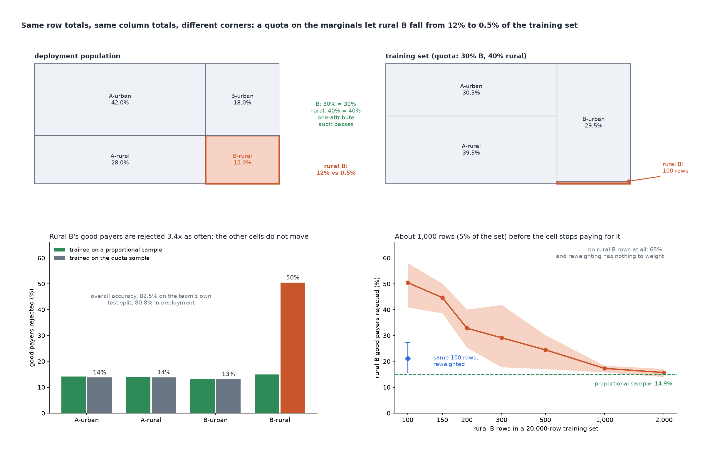

# The Training Set Is Not the Population

[](https://colab.research.google.com/github/phoebefu6/phoebe-the-builder/blob/main/data-quality-governance/sampling-bias-audit/demo.ipynb)
[](https://mybinder.org/v2/gh/phoebefu6/phoebe-the-builder/main?labpath=data-quality-governance/sampling-bias-audit/demo.ipynb)

> Our training data matched the population on every attribute we checked. It still had almost none of the one group the model then got wrong: half of rural B's good payers were rejected, and overall accuracy moved less than 2 points.



## The short version

Loan applicants come from two groups (B is 30%) and two regions (rural is 40%), so four cells: rural B is 12% of
the people the model will score. Rural B applicants are "thin file": their bureau history understates their real
track record by 1.5 sd, so a model has to see enough of them to learn the offset.

The training set (20,000 rows) was assembled with **quotas on the marginals**: 30% B, 40% rural, both exact. The
cells were never checked, and rural B came out at **0.5% (100 rows)**. Gradient boosting is fitted on it and scored
on a 60,000-applicant deployment population. Three seeds, min-max spread.

| check | result |
|---|---|
| one-attribute audit (group, region) | ratio 1.00 and 1.00, passes |
| cell audit (training share / population share, 99% Wilson) | rural B ratio **0.04**, flagged; proportional control: 0 flags |
| rural B good payers rejected | **50.5%** [40.9-58.0] vs 14.9% if trained on a proportional sample |
| the other three cells | within 0.5 pts of the proportional model |
| overall accuracy | 82.5% on the team's own test split, 80.8% in deployment |

| fix for rural B | good payers rejected |
|---|---:|
| reweight the 100 rows (24x) | 21.0% [15.6-27.3], noisy |
| no rural B rows, reweighted | 65.3%, nothing to weight |
| collect: 300 / 500 / 1,000 / 2,000 rows | 29.1% / 24.5% / **17.3%** / 15.7% |

**What to do:** audit the intersections you deploy on, not each attribute alone, and put an interval on each share
so a small segment is not flagged on noise. A quota on the marginals says nothing about the corners.

## Business Impact
- **Before:** a representativeness check compares each sensitive attribute's share to the population and passes.
- **After:** every deployed cell gets a ratio, an interval and a flag, plus a rows-needed curve for the flagged one.
- **Estimated ROI:** catches the segment a model will fail before deployment; one audit run is seconds.

## Tech Stack
Python, NumPy, scikit-learn (HistGradientBoosting), matplotlib, Streamlit, pytest, Docker.

## Demo

**[Run the interactive demo notebook →](demo.ipynb)** — pre-rendered with outputs, or click the Colab/Binder badges above to run it live.

For the Streamlit app (enter your own training-set cell shares):
```bash
pip install -r requirements.txt
python evidence.py && python make_chart.py   # writes results.json, evidence.txt, audit.png
streamlit run app.py
```

Files: `audit.py` (engine), `evidence.py` (the study, writes `evidence.txt`), `make_chart.py` (figure with a
geometry self-check, including no annotation crossing a drawn cell), `build_notebook.py` (notebook generator,
engine extracted by AST), 23 tests.

## Learning Connection
Built while studying responsible-AI and data governance material. Applies: stratified vs quota sampling,
post-stratification weights, Wilson intervals, per-segment error analysis.

## Impact Note
- **Who benefits:** model risk, fairness reviewers, and data teams assembling training sets.
- **Potential risks:** the world is constructed, so the 1,000-row number is this world's, not a rule; run the curve
  on your own data. Reweighting is shown to help, but a 24x weight is a noisy fix, and an empty cell cannot be
  weighted at all.
