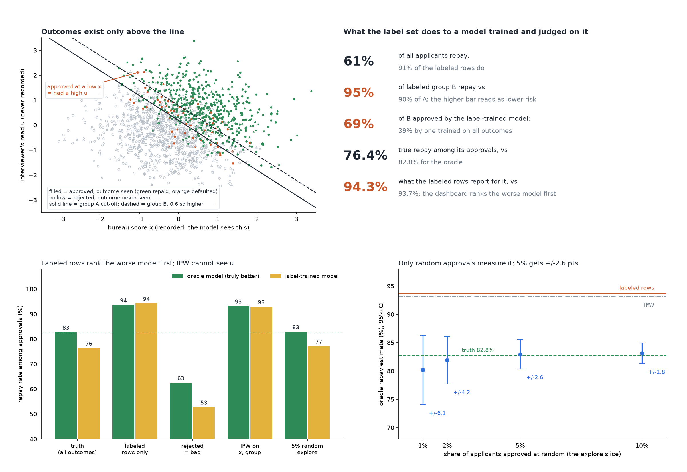

# We Only Know Outcomes for the People We Approved

[](https://colab.research.google.com/github/phoebefu6/phoebe-the-builder/blob/main/data-quality-governance/selective-labels/demo.ipynb)
[](https://mybinder.org/v2/gh/phoebefu6/phoebe-the-builder/main?labpath=data-quality-governance/selective-labels/demo.ipynb)

> We only ever see repayment for the loans we approved, so every model is trained and judged on past decisions. Ours ranked the worse model first, turned a higher bar against one group into a tilt toward it, and the standard correction could not tell.



## The short version

Loan officers approved 40% of applicants using the bureau score **and an interview read nobody recorded**, and held
group B (30% of applicants) to a 0.6 sd higher bar. Repayment exists only for the people they approved. A new model
(gradient boosting on bureau score and group) is trained on those labels and approves the top 40%. Two history
periods of 40,000 applicants, three seeds, min-max spread. The truth, which only a simulation has, is the referee.

| | result |
|---|---|
| repay rate: all applicants vs labeled rows | 61.3% vs **90.9%** |
| labeled repay rate, B vs A | 94.7% vs 89.9%: the higher bar reads as lower risk |
| share of B approved: label-trained vs oracle model | **69.0%** vs 39.3% |
| true repay among approvals: label-trained vs oracle | 76.4% vs **82.8%** |

| estimator | oracle | label-trained | ranks right? | oracle TPR gap A-B |
|---|---:|---:|---|---:|
| truth (all outcomes) | 82.8% | 76.4% | yes | +2.0 pts |
| labeled rows only | 93.7% | **94.3%** | **NO, at every seed** | -5.7 (sign flipped) |
| rejected = bad | 62.5% | 52.7% | yes, 20 pts low | -5.7 |
| IPW on score + group | 93.2% | 92.9% | tie (ranges overlap) | -0.2 |
| 5% random explore | 82.9% | 77.1% | yes | +4.3 |

| random-explore slice | labeled approvals | 95% CI on repay |
|---|---:|---:|
| 1% / 2% / 5% / 10% | 162 / 325 / 804 / 1,623 | +/-6.1 / 4.2 / **2.6** / 1.8 pts |

**Control (officers used recorded data only, `sel_u = 0`):** IPW recovers the repay rate (82.5% vs 82.8%) and
training on labels costs nothing (82.3%). The method works; the world broke it. **Negative result that survives
the control:** IPW still reads group B's TPR as 67.2% against a true 53.2%. A quarter of B's good payers had under
a 2% chance of approval and only 3 of them carry a label; lowering the propensity clip from 0.02 to 1e-6 moves it
0.5 pts. No weight reaches someone who was never approved.

**What to do:** keep a small random-approval slice and evaluate every model on it; treat labeled-row metrics as
optimistic and unrankable when past decisions used anything you did not record; never run a fairness audit on
labels alone.

## Business Impact
- **Before:** a challenger model is evaluated on last year's approved loans and promoted because it scores higher.
- **After:** the same comparison is made four ways next to the one unbiased estimate, with the slice size it needs.
- **Estimated ROI:** avoids promoting a model 6.4 pts worse on true repayment; one run is seconds.

## Tech Stack
Python, NumPy, scikit-learn (HistGradientBoosting), matplotlib, Streamlit, pytest, Docker.

## Demo

**[Run the interactive demo notebook →](demo.ipynb)** — pre-rendered with outputs, or click the Colab/Binder badges above to run it live.

For the Streamlit app (change how the past decisions were made):
```bash
pip install -r requirements.txt
python evidence.py && python make_chart.py   # writes results.json, evidence.txt, audit.png
streamlit run app.py
```

Files: `selective.py` (engine), `evidence.py` (the study, writes `evidence.txt`), `make_chart.py` (figure with a
geometry self-check, including the legend frame against bar labels), `build_notebook.py` (notebook generator,
engine extracted by AST), 23 tests.

## Learning Connection
Built while studying responsible-AI and credit-risk material (selective labels, Lakkaraju et al. 2017; reject
inference). Applies: missing-not-at-random outcomes, inverse propensity weighting and its overlap condition,
exploration as an evaluation design.

## Impact Note
- **Who benefits:** credit risk, model validation and fairness reviewers; anyone whose labels come from past decisions (hiring, fraud, triage).
- **Potential risks:** the world is constructed, so the 5% number is this world's, not a rule. A random-approval
  slice means lending to people the score would refuse; it needs a loss budget and governance sign-off.
