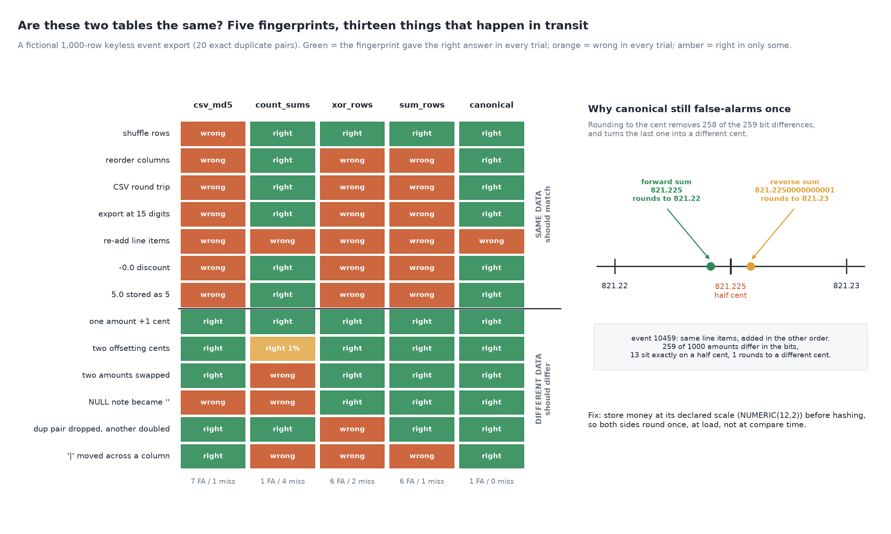

# Are These Two Tables the Same?

[](https://colab.research.google.com/github/phoebefu6/phoebe-the-builder/blob/main/data-quality-governance/table-checksum/demo.ipynb)
[](https://mybinder.org/v2/gh/phoebefu6/phoebe-the-builder/main?labpath=data-quality-governance/table-checksum/demo.ipynb)

> The table was copied to another system and you can compare one number from each side: a hash of the dump calls a shuffled copy different every time, row count plus column sums lets two swapped amounts through every time, an XOR of row hashes cannot see a duplicate pair, and even the fingerprint that gets the other 12 cases right false-alarms on one amount that sits on a half cent.



## The short version

NOT a row differ: `data-diff` (Day 100) and `reconciliation-checker` (Day 99) need both tables in one place and tell
you which rows moved. This scores the ONE number you compare when you cannot do that. A fictional 1,000-row keyless
order-event export (980 distinct rows, 20 exact duplicate pairs from retries; a note column with 478 NULLs and 151
empty strings; amounts summed in float from line items x 1.07), seeded `Random(207)`. Seven benign transforms (same
data, a fingerprint should MATCH) and six mutations (different data, it should DIFFER), 100 seeded trials for each
random one. Every number below is in `evidence.txt`.

| fingerprint | false alarms (of 7) | misses (of 6) | what it cannot see |
|---|---:|---:|---|
| `csv_md5`: md5 of the dump | 7 | 1 | anything but row order; NULL vs '' (the CSV writer writes both as nothing) |
| `count_sums`: count + money column sums | 1 | 4 | two amounts swapped, offsetting cents, any text column, a moved `\|` |
| `xor_rows`: XOR of row hashes | 6 | 2 | a duplicate pair (it XORs to zero); a moved `\|` |
| `sum_rows`: sum of row hashes mod 2^64 | 6 | 1 | a moved `\|` |
| `canonical`: sum over typed rows | **1** | **0** | a value one ulp either side of a half cent |

- **The dump hash is a row-order test.** Shuffling the rows breaks it in 100 of 100 trials; it false-alarms on all 7
  benign transforms, which in practice means nobody looks at it after the first week.
- **Column sums are quiet and blind.** They survive every benign transform but one and pass 4 of 6 real changes:
  two amounts swapped between rows (100 of 100), two offsetting cents (99 of 100), a NULL note turned into an empty
  string, and a `|` moved from the customer into the note.
- **XOR cancels pairs, and keyless tables have pairs.** When a dedup step dropped both copies of one retried event
  and a retry wrote another event twice, the XOR fingerprint matched in 100 of 100 trials. Summing instead of
  XOR-ing fixes it: a sum is a multiset fingerprint.
- **The serialisation is the fingerprint.** Joining a row with `|` makes `Ada Lim|` + `gift` and `Ada Lim` + `|gift`
  the same string. `str()` makes 5.0 and 5, -0.0 and 0.0, 0.30000000000000004 and 0.3 different strings. Canonical
  hashes a typed row: columns sorted by name, money quantised to the cent, NULL a token no string can produce, each
  string length-prefixed - and it needs the schema DECLARED to do that.

**Negative result (the ceiling):** the target re-added the same line items in the opposite order. 259 of 1,000
amounts differ in the bits; rounding to the cent folds back all but one. Thirteen true amounts sit exactly on a half
cent, and for event 10459 the forward sum is 821.225 (rounds to 821.22) and the reverse sum 821.2250000000001 (rounds
to 821.23). Any fingerprint that rounds at compare time has a boundary; no choice of hash or rounding mode removes it.

**What to do:** compare a typed, order-independent, multiset fingerprint (sum of row hashes over a canonical
serialisation), with the column types written down on both sides. Round money once, at load, to the declared scale
(`NUMERIC(12,2)`), so both systems hash the same stored value. Keep count + sums as a second, human-readable line
in the report, never as the test. When the fingerprints differ, then ship the rows to a differ.

## Business Impact
- **Before:** a migration or replication was signed off on matching row counts and column totals, or abandoned
  because a dump hash never matched.
- **After:** one 16-hex-digit fingerprint per side, compared daily, that ignores row order, column order and type
  drift and catches swaps, NULL changes and duplicate churn.
- **Estimated ROI:** replaces a manual reconciliation per copied table; the first swapped-amount case it catches is
  a finance restatement avoided.

## Tech Stack
Python standard library (hashlib, decimal, csv), matplotlib, Streamlit, pytest, Docker.

## Demo

**[Run the interactive demo notebook →](demo.ipynb)** - pre-rendered with outputs, or click the Colab/Binder badges above to run it live.

For the Streamlit app (paste two tables as CSV; see all five fingerprints and their verdicts, with column types
read from the data):
```bash
pip install -r requirements.txt
python evidence.py && python make_chart.py   # writes results.json, evidence.txt, audit.png
streamlit run app.py
```

Files: `explore.py` (table, fingerprints, transforms, mutations, scoring), `evidence.py` (writes `evidence.txt`),
`make_chart.py` (figure with a geometry self-check), `build_notebook.py` (generates `demo.ipynb`), `test_*.py`.

## Learning Connection
Built while studying data engineering for the CDAIO track (data validation across systems, order-independent
aggregate hashing, floating-point representation and decimal scale).
Applies: choosing a whole-table fingerprint by what it must ignore and what it must catch, and finding the case no
fingerprint can settle.

## Impact Note
- **Who benefits:** data engineers signing off migrations, replications and CDC pipelines; anyone asked "did the
  copy match?" without access to both tables at once.
- **Potential risks:** a matching fingerprint is only as good as the declared types; declare a column `str` that one
  side stores as a number and canonical will false-alarm. md5 truncated to 64 bits is a checksum, not a security
  control: it detects accidents, not someone forging a match. The table and its transforms are fictional; a real
  pipeline will have its own drift (time zones, collations, trailing spaces) that needs its own canonical rule.
