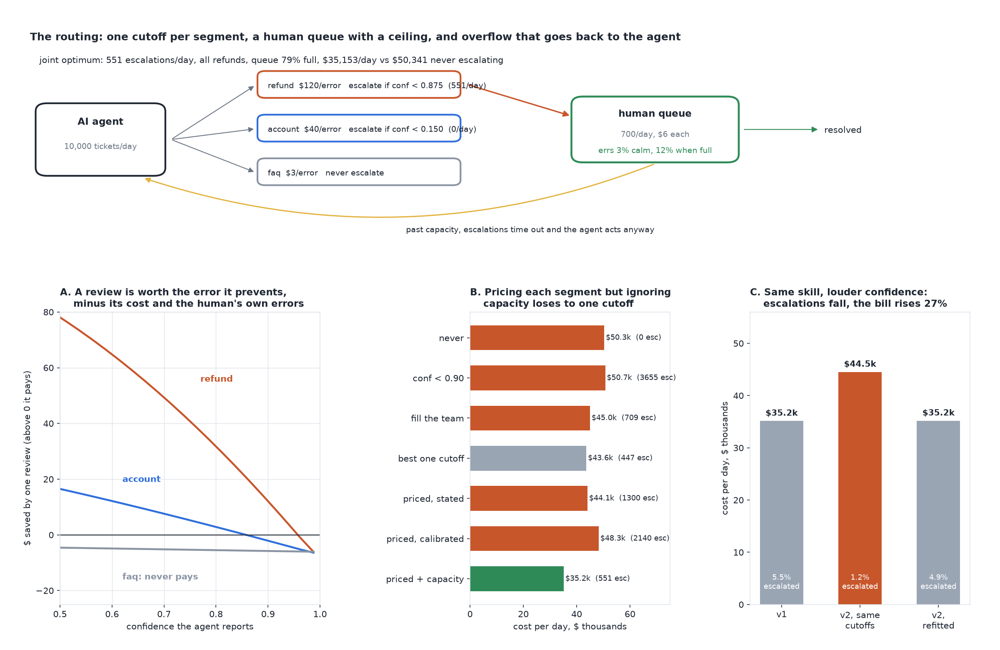

# When Should a Human Take Over?

[](https://colab.research.google.com/github/phoebefu6/phoebe-the-builder/blob/main/llmops-genai-platform/human-escalation-policy/demo.ipynb)
[](https://mybinder.org/v2/gh/phoebefu6/phoebe-the-builder/main?labpath=llmops-genai-platform/human-escalation-policy/demo.ipynb)

> We told the AI agent to hand anything under 90% confidence to a person. It sent 3,655 tickets a day to a team that can review 700, and the day cost more than letting the agent decide everything.



## The short version

An AI support agent handles 10,000 tickets a day across three segments: refunds (a wrong action costs $120),
account changes ($40) and FAQ answers ($3). For each ticket it reports a confidence. A policy is one cutoff per
segment: below it, a human takes the ticket. The human team costs $6 a review, can do 700 a day, gets 3% wrong
with a calm queue and 12% wrong when the queue is full. Escalations past capacity time out and the agent acts
anyway. The world is constructed and declared; every cost is exact on 40 confidence bins.

`threshold-explorer` picks one binary cutoff with two error prices. `calibration-checker` asks whether a 0.9
means 90%. This build adds what both leave out: a human team with a ceiling, and its own error rate.

| policy | escalated/day | queue reviewed | human error | cost/day | vs never |
|---|---:|---:|---:|---:|---:|
| never escalate | 0 | - | 3.0% | $50,341 | |
| escalate if conf < 0.90 | 3,655 | 19% | 12.0% | $50,712 | +0.7% |
| fill the team exactly | 709 | 99% | 12.0% | $44,998 | -10.6% |
| best single cutoff | 447 | 100% | 3.0% | $43,633 | -13.3% |
| priced per segment, stated confidence | 1,300 | 54% | 12.0% | $44,063 | -12.5% |
| priced per segment, calibrated | 2,140 | 33% | 12.0% | $48,277 | -4.1% |
| **priced + capacity, chosen jointly** | **551** | **100%** | **5.6%** | **$35,153** | **-30.2%** |

## What it found

1. **The common rule costs more than doing nothing.** "Escalate below 90% confidence" asks for 3,655 reviews a day
   from a 700-a-day team. The queue drops 81% of them back to the agent, and the reviews it does reach run at a 12%
   human error rate. The day costs 0.7% more than never escalating.
2. **Pricing errors correctly still loses when capacity binds.** Chow's reject rule, with a fallible reviewer,
   says escalate when (1 - p) x cost > review cost + human error x cost. Applied per segment with calibrated
   probabilities, it asks for 2,140 reviews and costs $48,277, worse than one plain cutoff ($43,633). Calibration
   finds more tickets worth a review than the team can take.
3. **The winner prices the errors and respects the ceiling.** Choosing the three cutoffs jointly sends every review
   to refunds (below 0.875 confidence), none to account changes or FAQ, and stops the queue at 79% full, before
   reviewers start to slip: $35,153 a day, 19.4% below the best single cutoff.
4. **The textbook rule is right without the ceiling.** With unlimited capacity, calibrated pricing costs $26,357
   against the joint optimum's $26,069. The trap is the capacity, not the economics.
5. **More escalation is not always safer.** Scaling the priced cutoffs, cost falls until demand reaches 80% of
   capacity ($36,900), then rises as overflow and tired reviewers eat the gain; at 5.7x demand it is worse than
   never escalating.
6. **Same skill, louder confidence, higher bill.** A model version that is exactly as accurate but reports higher
   numbers (0.81 skill now reads 0.90) cuts the escalation rate from 5.51% to 1.21% under the same cutoffs. A
   deflection dashboard calls that a win; the day costs 26.7% more, mostly refunds no human sees. Refitting the
   cutoffs on the new version's labels recovers it ($35,192). A threshold belongs to a model version.
7. **Negative result.** No FAQ review ever pays for itself: the best FAQ ticket a human could see saves -$3.2.
   Any rule that sends FAQs to people is spending review capacity to lose money.

Calibration: 21 of 21 exact per-segment error rates sit inside the 99% Wilson interval of 40 simulated days
(seed 195), across all seven policies. Full output in [evidence.txt](evidence.txt).

## Business Impact
- **Before:** the escalation cutoff is a round number chosen for comfort, the human queue overflows silently, and a
  falling escalation rate after a model upgrade is reported as better deflection.
- **After:** each segment's cutoff is priced by the error it prevents, chosen jointly under the team's capacity,
  and refitted on every model version.
- **Estimated ROI:** in this world, $8,480 a day against the best single cutoff, for 104 more reviews a day, all
  of them on refunds, and still inside the team's capacity.

## Tech Stack
Python, NumPy (exact expected cost on a confidence grid), Matplotlib, Streamlit, pytest, Docker.

## Demo

**[Run the interactive demo notebook →](demo.ipynb)** - pre-rendered with outputs, or click the Colab/Binder badges above to run it live.

For the Streamlit app (set your team's capacity, review cost and error rates):
```bash
pip install -r requirements.txt
python evidence.py && python make_chart.py
streamlit run app.py
```

## Files
- `escalation.py` - the engine: segments, calibration, inflation, policies, joint search, simulation
- `evidence.py` - runs the study, writes `results.json` and `evidence.txt`
- `make_chart.py` - the audit figure, with a geometry self-check before saving
- `build_notebook.py` - generates `demo.ipynb` with the engine extracted from `escalation.py`
- `test_escalation.py`, `test_notebook.py`, `test_app.py` - 33 tests

## Learning Connection
Built while studying human-in-the-loop design for LLM agents (Chow's 1970 reject option, selective prediction,
and learning-to-defer). Applies: cost-sensitive abstention, calibration as an input to a decision, and capacity as
a constraint that couples per-segment choices.

## Impact Note
- **Who benefits:** teams running AI agents with a human fallback: support, operations, claims, moderation.
- **Potential risks:** every number here comes from a constructed world. Human error rising with load is declared,
  not measured; measure your own reviewers before trusting the shape. The joint optimum gives account changes no
  human review at all, which may be unacceptable for compliance reasons that a cost model does not see. Set a floor
  for any segment where a review is required regardless of cost.
